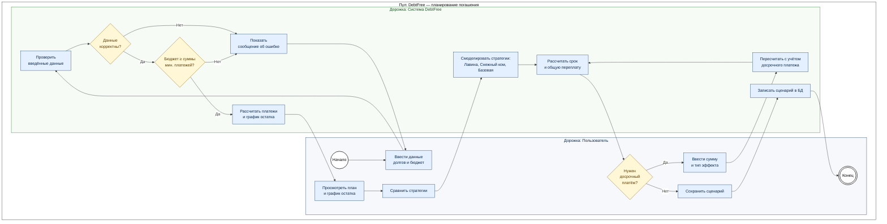
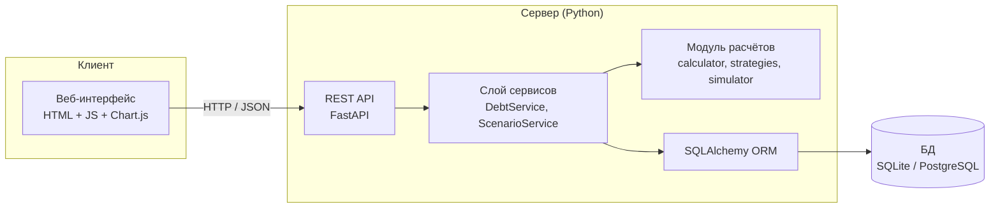

# DebtFree — планировщик погашения долгов

Веб-приложение на Python, которое помогает спланировать погашение кредитов и долгов: рассчитывает платежи, строит график остатка, сравнивает стратегии погашения и показывает общую переплату, в том числе при досрочных платежах.

> **Статус:** этап проектирования (диаграммы + базовый отчёт). Код будет добавлен на следующем этапе.
> Полный отчёт с ТЗ и бизнес-логикой: [`docs/REPORT.md`](docs/REPORT.md)

## Содержание

1. [Функциональные возможности](#1-функциональные-возможности)
2. [Диаграмма вариантов использования (Use Case)](#2-диаграмма-вариантов-использования-use-case)
3. [Диаграмма бизнес-процесса (BPMN)](#3-диаграмма-бизнес-процесса-bpmn)
4. [ER-диаграмма базы данных](#4-er-диаграмма-базы-данных)
5. [Макет интерфейса](#5-макет-интерфейса)
6. [Дополнительные диаграммы](#6-дополнительные-диаграммы)
7. [Технологии и структура проекта](#7-технологии-и-структура-проекта)

---

## 1. Функциональные возможности

| № | Функция | Описание |
|---|---------|----------|
| F1 | Учёт долгов | Добавление, изменение и удаление кредитов: остаток, годовая ставка, минимальный платёж, срок, тип платежа |
| F2 | Ежемесячные платежи | Расчёт аннуитетного и дифференцированного платежа |
| F3 | График остатка долга | Помесячный график погашения (платёж, основной долг, проценты, остаток) |
| F4 | Сравнение стратегий | «Лавина», «Снежный ком» и базовый вариант «только минимальные платежи» |
| F5 | Общая переплата | Сумма процентов и срок погашения для каждой стратегии |
| F6 | Досрочное погашение | Пересчёт с разовым или регулярным досрочным платежом (сократить срок / снизить платёж) |
| F7 | Сценарии | Сохранение расчётов, чтобы вернуться к ним позже |

---

## 2. Диаграмма вариантов использования (Use Case)

Нотация UML: актёры — вне границы системы, варианты использования — внутри границы «Система DebtFree». Пунктирные стрелки: `«include»` — обязательное включение, `«extend»` — необязательное расширение (стрелка направлена от расширяющего варианта к базовому).

### 2.1. Блок 1. Аккаунт

```mermaid
flowchart LR
    subgraph BG[" "]
        direction LR
        G["Гость"]
        U["Пользователь"]

        subgraph SYS[" "]
            direction TB
            UC1(["UC-1<br/>Зарегистрироваться"])
            UC2(["UC-2<br/>Войти в систему"])
            UC3(["UC-3<br/>Выйти из системы"])
        end

        G --- UC1
        G --- UC2
        U --- UC3
    end

    style BG fill:#000000,stroke:#000000
    style SYS fill:#0b0b0b,stroke:#e5e7eb,color:#ffffff
    linkStyle default stroke:#9ca3af,stroke-width:1.5px
```


| ID | Действие | Зачем | Что происходит |
|----|----------|-------|----------------|
| UC-1 | Зарегистрироваться | Создать личный кабинет | Ввести email и пароль → система проверяет, что email свободен → создаёт учётную запись |
| UC-2 | Войти в систему | Получить доступ к своим долгам | Ввести email и пароль → система проверяет → открывает список долгов. После входа Гость становится Пользователем |
| UC-3 | Выйти из системы | Закрыть доступ к данным на чужом устройстве | Нажать «Выйти» → сессия завершается |

---
### 2.2. Блок 2. Учёт долгов

```mermaid
flowchart LR
    subgraph BG[" "]
        direction LR
        U["Пользователь"]

        subgraph SYS[" "]
            direction LR
            UC4(["UC-4<br/>Просмотреть список долгов"])
            UC5(["UC-5<br/>Добавить долг"])
            UC6(["UC-6<br/>Изменить долг"])
            UC7(["UC-7<br/>Удалить долг"])
            UC8(["UC-8<br/>Проверить корректность<br/>данных долга"])
        end

        %% 1) пользователь сначала открывает список долгов
        U --- UC4

        %% 2) из списка ответвляются действия (стрелка «extend» указывает на UC-4)
        UC4 <-. "«extend»" .- UC5
        UC4 <-. "«extend»" .- UC6
        UC4 <-. "«extend»" .- UC7

        %% 3) добавление и изменение всегда проходят проверку
        UC5 -. "«include»" .-> UC8
        UC6 -. "«include»" .-> UC8
    end

    style BG fill:#000000,stroke:#000000
    style SYS fill:#0b0b0b,stroke:#e5e7eb,color:#ffffff
    linkStyle default stroke:#9ca3af,stroke-width:1.5px
```
| ID | Действие | Зачем | Что происходит |
|----|----------|-------|----------------|
| UC-4 | Просмотреть список долгов | Увидеть все долги, общую сумму и сумму минимальных платежей | Система показывает таблицу долгов. Отсюда пользователь переходит к UC-5, UC-6, UC-7 (поэтому `extend`) |
| UC-5 | Добавить долг | Внести кредит, чтобы по нему можно было считать | Нажать «+ Добавить долг» → заполнить название, остаток, ставку, мин. платёж, срок, тип платежа → «Сохранить» |
| UC-6 | Изменить долг | Исправить ошибку или обновить остаток | В списке нажать значок редактирования → изменить поля → «Сохранить» |
| UC-7 | Удалить долг | Убрать погашенный или лишний долг | В списке нажать значок удаления → подтвердить |
| UC-8 | Проверить корректность данных | Не допустить неверных данных (служебное, выполняет система) | Остаток > 0; ставка 0–100 %; мин. платёж покрывает проценты. При ошибке показывается сообщение |
---

### 2.3. Блок 3. Расчёты и сравнение

```mermaid
flowchart LR
    subgraph BG[" "]
        direction LR
        U["Пользователь"]

        subgraph SYS[" "]
            direction TB
            UC9(["UC-9<br/>Задать ежемесячный бюджет"])
            UC10(["UC-10<br/>Рассчитать ежемесячные платежи"])
            UC11(["UC-11<br/>Построить график остатка долга"])
            UC12(["UC-12<br/>Рассчитать общую переплату"])
            UC13(["UC-13<br/>Сравнить стратегии погашения"])
        end

        U --- UC9
        U --- UC11
        U --- UC13

        UC11 -. "«include»" .-> UC10
        UC13 -. "«include»" .-> UC9
        UC13 -. "«include»" .-> UC10
        UC13 -. "«include»" .-> UC12
    end

    style BG fill:#000000,stroke:#000000
    style SYS fill:#0b0b0b,stroke:#e5e7eb,color:#ffffff
    linkStyle default stroke:#9ca3af,stroke-width:1.5px
```


| ID | Действие | Зачем | Что происходит |
|----|----------|-------|----------------|
| UC-9 | Задать ежемесячный бюджет | Указать, сколько человек готов платить в месяц | Ввести сумму → система проверяет, что она не меньше суммы минимальных платежей |
| UC-10 | Рассчитать ежемесячные платежи | Основа для графика и сравнения (служебное) | Расчёт по формулам аннуитетного или дифференцированного платежа |
| UC-11 | Построить график остатка долга | Наглядно увидеть, как долг уменьшается по месяцам | Система считает платежи (UC-10) и строит линию остатка |
| UC-12 | Рассчитать общую переплату | Показать, во сколько обойдётся долг (служебное) | Сумма всех выплат минус первоначальная сумма долгов |
| UC-13 | Сравнить стратегии погашения | Понять, какой порядок гашения выгоднее | Система берёт бюджет (UC-9), считает платежи (UC-10) и переплату (UC-12) для «Лавины», «Снежного кома» и базового варианта |
---

### 2.4. Блок 4. Досрочное погашение и сценарии

UC-13 показан здесь повторно из блока 3, потому что от него отходят действия «по желанию».

```mermaid
flowchart LR
    subgraph BG[" "]
        direction LR
        U["Пользователь"]

        subgraph SYS[" "]
            direction LR
            UC13(["UC-13<br/>Сравнить стратегии погашения<br/>(из блока 3)"])
            UC14(["UC-14<br/>Смоделировать<br/>досрочное погашение"])
            UC15(["UC-15<br/>Выбрать эффект платежа:<br/>сократить срок или снизить платёж"])
            UC16(["UC-16<br/>Сохранить сценарий"])
            UC17(["UC-17<br/>Просмотреть сохранённые сценарии"])
            UC18(["UC-18<br/>Удалить сценарий"])
        end

        %% Цепочка 1: сначала сравнение стратегий, затем ответвления
        U --- UC13
        UC13 <-. "«extend»" .- UC14
        UC13 <-. "«extend»" .- UC16
        UC14 -. "«include»" .-> UC15

        %% Цепочка 2: сначала список сценариев, затем удаление
        U --- UC17
        UC17 <-. "«extend»" .- UC18
    end

    style BG fill:#000000,stroke:#000000
    style SYS fill:#0b0b0b,stroke:#e5e7eb,color:#ffffff
    linkStyle default stroke:#9ca3af,stroke-width:1.5px
```
| ID | Действие | Зачем | Что происходит |
|----|----------|-------|----------------|
| UC-14 | Смоделировать досрочное погашение | Узнать, сколько сэкономит дополнительный платёж | После сравнения ввести сумму досрочного платежа → система пересчитывает срок и переплату |
| UC-15 | Выбрать эффект платежа | Решить, что важнее: закончить раньше или платить меньше (шаг внутри UC-14) | Выбрать «сократить срок» или «снизить платёж» |
| UC-16 | Сохранить сценарий | Вернуться к результату позже | Нажать «Сохранить» → ввести название → система записывает результат в БД |
| UC-17 | Просмотреть сохранённые сценарии | Сравнить разные расчёты между собой | Открыть «Сценарии» → выбрать из списка → увидеть параметры и результаты |
| UC-18 | Удалить сценарий | Убрать ненужный расчёт | В списке сценариев нажать значок удаления → подтвердить |
---

**Описание актёров**

| Актёр | Описание |
|-------|----------|
| Гость | Неавторизованный посетитель, может только зарегистрироваться или войти |
| Пользователь | Авторизованный пользователь, владелец своих долгов и сценариев |

## 3. Диаграмма бизнес-процесса (BPMN)

Процесс «Планирование погашения долгов» в нотации BPMN 2.0: две дорожки (lanes) внутри пула, события (круги), задачи (прямоугольники), исключающие шлюзы (ромбы). Диаграмма построена средствами Mermaid, поэтому изображение приближено к BPMN-нотации: дорожки показаны как вложенные группы.



| Элемент BPMN | Обозначение на диаграмме |
|--------------|--------------------------|
| Начальное событие | Круг «Начало» |
| Конечное событие | Двойной круг «Конец» |
| Задача (Task) | Прямоугольник |
| Исключающий шлюз (XOR) | Ромб с вопросом, исходящие потоки подписаны «Да» / «Нет» |
| Дорожки (Lanes) | Группы «Пользователь» и «Система DebtFree» внутри пула |

---

## 4. ER-диаграмма базы данных

Нотация: таблицы содержат поля с типами; **PK** — первичный ключ, **FK** — внешний ключ. Каждая стрелка начинается в поле-FK дочерней таблицы (точка, `N`) и заканчивается в конкретном поле-PK родительской таблицы (наконечник, `1`).


**Перечень связей (поле → поле)**

| Дочернее поле (FK) | Родительское поле (PK) | Смысл |
|--------------------|------------------------|-------|
| `debts.user_id` | `users.id` | Долг принадлежит пользователю |
| `scenarios.user_id` | `users.id` | Сценарий принадлежит пользователю |
| `scenarios.strategy_id` | `strategies.id` | Сценарий использует стратегию |
| `scenario_debts.scenario_id` | `scenarios.id` | Состав сценария (связь M:N с долгами) |
| `scenario_debts.debt_id` | `debts.id` | Состав сценария (связь M:N со сценариями) |
| `payment_schedule.scenario_id` | `scenarios.id` | Строка графика относится к сценарию |
| `payment_schedule.debt_id` | `debts.id` | Строка графика относится к долгу |
| `extra_payments.scenario_id` | `scenarios.id` | Досрочный платёж в рамках сценария |
| `extra_payments.debt_id` | `debts.id` | Досрочный платёж по долгу |

---

## 5. Макет интерфейса

Низкодетальный макет (wireframe) четырёх основных экранов: список долгов, форма добавления долга, сравнение стратегий, график остатка с досрочным погашением.


---

## 6. Дополнительные диаграммы

### 6.1. Архитектура (компонентная диаграмма)


---

## 7. Технологии и структура проекта

| Слой | Технологии |
|------|------------|
| Язык и расчёты | Python 3.11+, `decimal` |
| Backend | FastAPI, Pydantic |
| БД | PostgreSQL |
| Frontend | HTML, CSS, JavaScrip |
| Тесты | pytest |

```text
debtfree/
├── app/
│   ├── api/            # маршруты FastAPI
│   ├── core/           # расчёты: calculator.py, strategies.py, simulator.py
│   ├── models/         # SQLAlchemy-модели
│   ├── schemas/        # Pydantic-схемы
│   └── services/       # бизнес-сервисы
├── frontend/           # статические страницы и JS
├── tests/              # unit-тесты расчётного модуля
├── docs/
│   ├── REPORT.md       # отчёт (ТЗ, бизнес-логика)
│   ├── erd.svg         # ER-диаграмма
│   └── mockup.svg      # макет интерфейса
└── README.md
```
