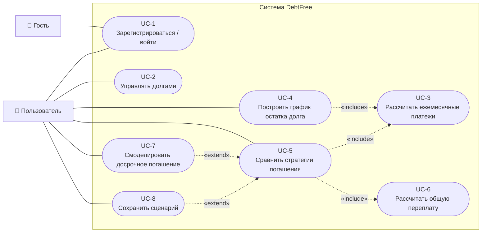
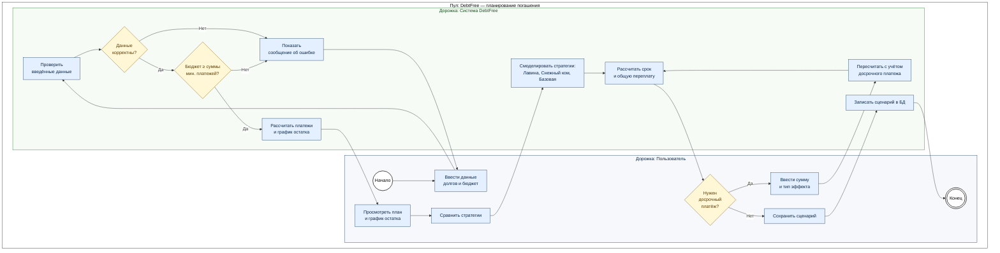
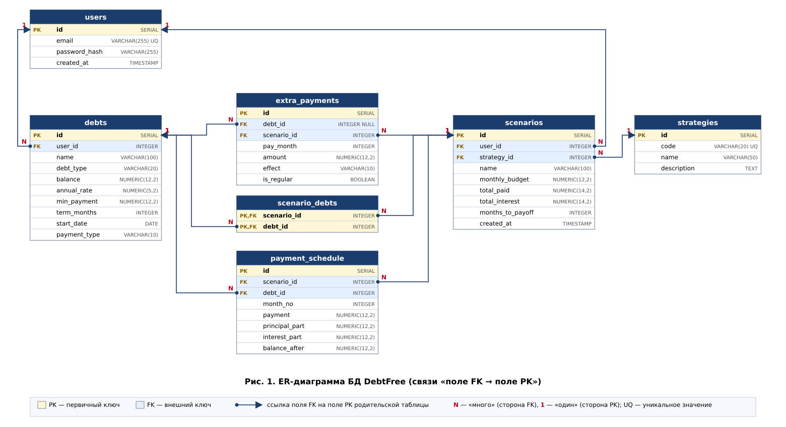
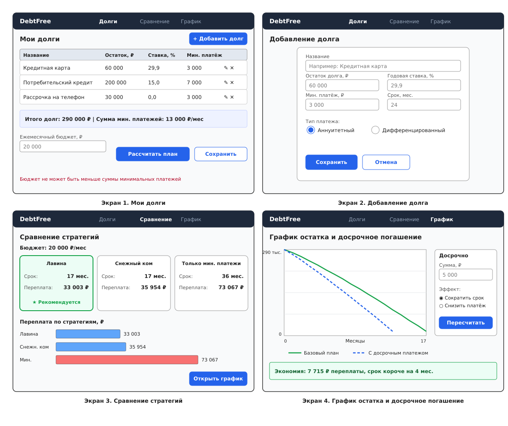
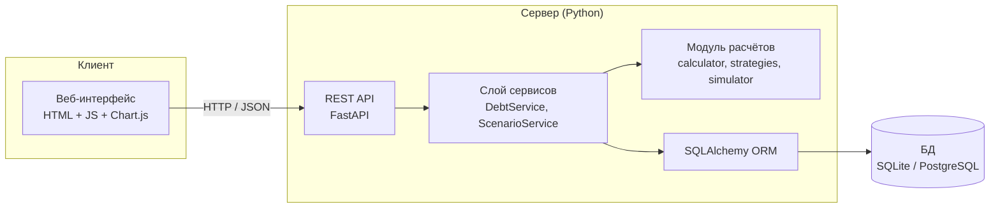
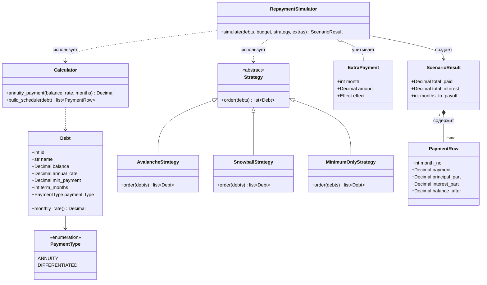
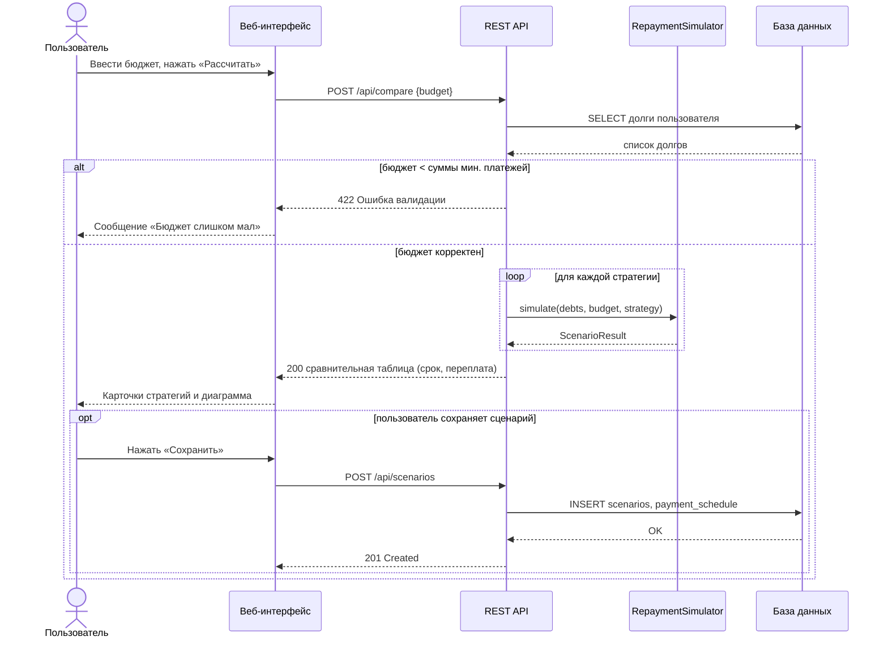

# DebtFree — планировщик погашения долгов

Веб-приложение на Python, которое помогает спланировать погашение кредитов и долгов: рассчитывает платежи, строит график остатка, сравнивает стратегии погашения и показывает общую переплату, в том числе при досрочных платежах.

> **Статус:** этап проектирования (диаграммы + базовый отчёт). Код будет добавлен на следующем этапе.
> Полный отчёт с ТЗ и бизнес-логикой: [`docs/REPORT.md`](docs/REPORT.md)

## Содержание

1. [Функциональные возможности](#1-функциональные-возможности)
2. [Диаграмма вариантов использования (Use Case)](#2-диаграмма-вариантов-использования-use-case)
3. [Диаграмма бизнес-процесса (BPMN)](#3-диаграмма-бизнес-процесса-bpmn)
4. [ER-диаграмма базы данных](#4-er-диаграмма-базы-данных)
5. [Макет интерфейса](#5-макет-интерфейса)
6. [Дополнительные диаграммы](#6-дополнительные-диаграммы)
7. [Технологии и структура проекта](#7-технологии-и-структура-проекта)

---

## 1. Функциональные возможности

| № | Функция | Описание |
|---|---------|----------|
| F1 | Учёт долгов | Добавление, изменение и удаление кредитов: остаток, годовая ставка, минимальный платёж, срок, тип платежа |
| F2 | Ежемесячные платежи | Расчёт аннуитетного и дифференцированного платежа |
| F3 | График остатка долга | Помесячный график погашения (платёж, основной долг, проценты, остаток) |
| F4 | Сравнение стратегий | «Лавина», «Снежный ком» и базовый вариант «только минимальные платежи» |
| F5 | Общая переплата | Сумма процентов и срок погашения для каждой стратегии |
| F6 | Досрочное погашение | Пересчёт с разовым или регулярным досрочным платежом (сократить срок / снизить платёж) |
| F7 | Сценарии | Сохранение расчётов, чтобы вернуться к ним позже |

---

## 2. Диаграмма вариантов использования (Use Case)

Нотация UML: актёры — вне границы системы, варианты использования — внутри границы «Система DebtFree». Пунктирные стрелки: `«include»` — обязательное включение, `«extend»` — необязательное расширение (стрелка направлена от расширяющего варианта к базовому).



**Описание актёров**

| Актёр | Описание |
|-------|----------|
| Гость | Неавторизованный посетитель, может только зарегистрироваться или войти |
| Пользователь | Авторизованный пользователь, владелец своих долгов и сценариев |

**Краткая спецификация основных вариантов**

| ID | Название | Предусловие | Основной поток | Результат |
|----|----------|-------------|----------------|-----------|
| UC-2 | Управлять долгами | Пользователь авторизован | Открыть «Мои долги» → ввести данные → система проверяет и сохраняет | Долг добавлен / изменён / удалён |
| UC-5 | Сравнить стратегии | Есть ≥ 1 долг, задан бюджет ≥ суммы мин. платежей | Ввести бюджет → система моделирует все стратегии → вывод сравнительной таблицы | Срок и переплата по каждой стратегии |
| UC-7 | Досрочное погашение | Выполнено сравнение (UC-5) | Ввести сумму и эффект → пересчёт | Новый график, экономия переплаты |

---

## 3. Диаграмма бизнес-процесса (BPMN)

Процесс «Планирование погашения долгов» в нотации BPMN 2.0: две дорожки (lanes) внутри пула, события (круги), задачи (прямоугольники), исключающие шлюзы (ромбы). Диаграмма построена средствами Mermaid, поэтому изображение приближено к BPMN-нотации: дорожки показаны как вложенные группы.



| Элемент BPMN | Обозначение на диаграмме |
|--------------|--------------------------|
| Начальное событие | Круг «Начало» |
| Конечное событие | Двойной круг «Конец» |
| Задача (Task) | Прямоугольник |
| Исключающий шлюз (XOR) | Ромб с вопросом, исходящие потоки подписаны «Да» / «Нет» |
| Дорожки (Lanes) | Группы «Пользователь» и «Система DebtFree» внутри пула |

---

## 4. ER-диаграмма базы данных

Нотация: таблицы содержат поля с типами; **PK** — первичный ключ, **FK** — внешний ключ. Каждая стрелка начинается в поле-FK дочерней таблицы (точка, `N`) и заканчивается в конкретном поле-PK родительской таблицы (наконечник, `1`).



**Перечень связей (поле → поле)**

| Дочернее поле (FK) | Родительское поле (PK) | Кратность | Смысл |
|--------------------|------------------------|-----------|-------|
| `debts.user_id` | `users.id` | N : 1 | Долг принадлежит пользователю |
| `scenarios.user_id` | `users.id` | N : 1 | Сценарий принадлежит пользователю |
| `scenarios.strategy_id` | `strategies.id` | N : 1 | Сценарий использует стратегию |
| `scenario_debts.scenario_id` | `scenarios.id` | N : 1 | Состав сценария (связь M:N с долгами) |
| `scenario_debts.debt_id` | `debts.id` | N : 1 | Состав сценария (связь M:N со сценариями) |
| `payment_schedule.scenario_id` | `scenarios.id` | N : 1 | Строка графика относится к сценарию |
| `payment_schedule.debt_id` | `debts.id` | N : 1 | Строка графика относится к долгу |
| `extra_payments.scenario_id` | `scenarios.id` | N : 1 | Досрочный платёж в рамках сценария |
| `extra_payments.debt_id` | `debts.id` | N : 1 | Досрочный платёж по долгу |

---

## 5. Макет интерфейса

Низкодетальный макет (wireframe) четырёх основных экранов: список долгов, форма добавления долга, сравнение стратегий, график остатка с досрочным погашением.



---

## 6. Дополнительные диаграммы

### 6.1. Архитектура (компонентная диаграмма)



### 6.2. Диаграмма классов (модуль расчётов)



### 6.3. Диаграмма последовательности: сравнение стратегий



---

## 7. Технологии и структура проекта

| Слой | Технологии |
|------|------------|
| Язык и расчёты | Python 3.11+, `decimal` |
| Backend | FastAPI, Pydantic |
| БД | SQLite (разработка) / PostgreSQL, SQLAlchemy, Alembic |
| Frontend | HTML, CSS, JavaScript, Chart.js |
| Тесты | pytest |

```text
debtfree/
├── app/
│   ├── api/            # маршруты FastAPI
│   ├── core/           # расчёты: calculator.py, strategies.py, simulator.py
│   ├── models/         # SQLAlchemy-модели
│   ├── schemas/        # Pydantic-схемы
│   └── services/       # бизнес-сервисы
├── frontend/           # статические страницы и JS
├── tests/              # unit-тесты расчётного модуля
├── docs/
│   ├── REPORT.md       # отчёт (ТЗ, бизнес-логика)
│   ├── erd.svg         # ER-диаграмма
│   └── mockup.svg      # макет интерфейса
└── README.md
```
