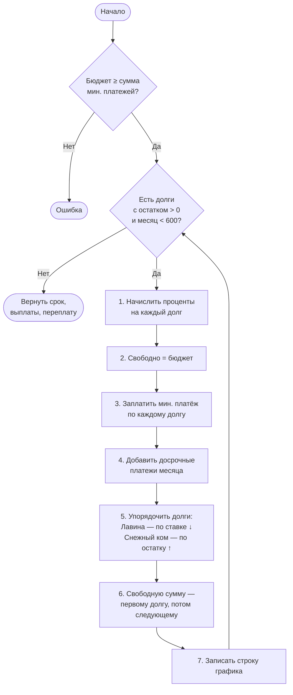
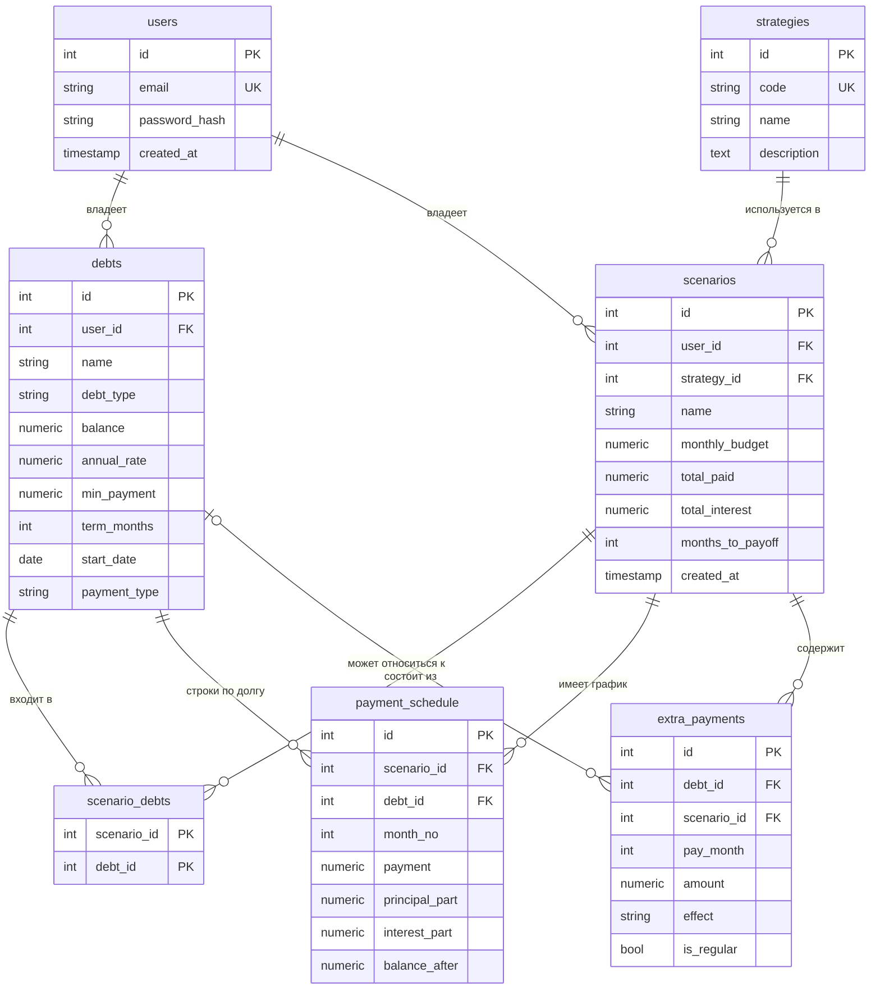
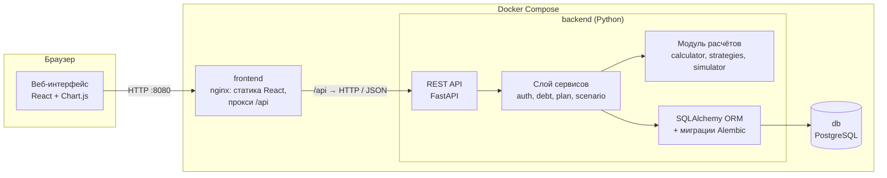

# Асаков — Аналитика и Архитектура

> Шпаргалка для защиты. Роль: **анализ предметной области, техническое задание, бизнес-логика (формулы и алгоритмы), диаграммы (Use Case, BPMN, ER, архитектура), словарь данных, проектирование API, план тестирования, макет интерфейса**.
>
> Как читать: сначала раздел 1 (рассказ на 2 минуты), потом разделы 2–10 (детали), в конце — раздел 11 с готовыми ответами на вопросы комиссии.
>
> Исходные материалы: [README.md](../README.md) (диаграммы) и [docs/REPORT.md](../docs/REPORT.md) (отчёт: ТЗ, бизнес-логика, словарь данных, API, тесты), [docs/erd.svg](../docs/erd.svg), [docs/mockup.svg](../docs/mockup.svg).

---

## Содержание

1. [Рассказ на 2 минуты](#1-рассказ-на-2-минуты)
2. [Анализ предметной области](#2-анализ-предметной-области)
3. [Техническое задание](#3-техническое-задание)
4. [Бизнес-логика: формулы и алгоритмы](#4-бизнес-логика-формулы-и-алгоритмы)
5. [Диаграмма вариантов использования (Use Case)](#5-диаграмма-вариантов-использования-use-case)
6. [Диаграмма бизнес-процесса (BPMN)](#6-диаграмма-бизнес-процесса-bpmn)
7. [ER-диаграмма и словарь данных](#7-er-диаграмма-и-словарь-данных)
8. [Архитектура системы](#8-архитектура-системы)
9. [Проектирование API и макет](#9-проектирование-api-и-макет)
10. [План тестирования и трассировка требований](#10-план-тестирования-и-трассировка-требований)
11. [Вопросы комиссии и ответы](#11-вопросы-комиссии-и-ответы)
12. [Шпаргалка](#12-шпаргалка)

---

## 1. Рассказ на 2 минуты

> «Я отвечал за аналитику и архитектуру. Начали с **анализа предметной области**: у людей часто несколько кредитов сразу — карта, потребительский кредит, рассрочка. Ставки и остатки разные, и непонятно, что гасить первым. Банковские калькуляторы считают **один** кредит, а DebtFree сравнивает **стратегии погашения нескольких долгов**.
>
> Я составил **техническое задание**: 9 функциональных требований (от регистрации до досрочного погашения) и 5 нефункциональных (скорость, точность денежных расчётов, хеширование паролей, адаптивность, покрытие тестами). Описал **бизнес-логику**: формулы аннуитетного и дифференцированного платежа, алгоритм моделирования стратегий «Лавина» и «Снежный ком», правила досрочного погашения и валидации — и посчитал **контрольный пример**, по которому потом проверялся код.
>
> Построил диаграммы: **Use Case** — 18 вариантов использования в 4 блоках; **BPMN** — процесс от входа до сохранения сценария в 6 дорожках; **ER-диаграмму** на 7 таблиц со словарём данных; **компонентную диаграмму** архитектуры. Спроектировал **REST API** на 15 маршрутов и **план тестирования** T1–T9.
>
> Архитектура — **трёхзвенная**: React-интерфейс, backend на FastAPI с выделенным расчётным модулем и PostgreSQL; всё в Docker Compose, наружу открыт только nginx. Реализация полностью соответствует проекту: контрольный пример совпал до копейки».

---

## 2. Анализ предметной области

### 2.1. Проблема

Человек одновременно платит по нескольким долгам. У каждого — свой остаток, ставка, минимальный платёж. Если есть деньги сверх минимальных платежей, возникают вопросы:
- на какой долг их направить?
- сколько я переплачу в итоге?
- когда я полностью рассчитаюсь?
- что даст досрочный платёж — сократить срок или уменьшить платёж?

### 2.2. Основные понятия

| Термин | Простыми словами |
|---|---|
| **Остаток (тело долга)** | Сколько ещё должен без учёта процентов |
| **Годовая ставка** | Сколько процентов за год начисляется на остаток |
| **Аннуитетный платёж** | Каждый месяц одна и та же сумма; в начале больше процентов, в конце — тела |
| **Дифференцированный платёж** | Тело гасится равными долями, проценты на остаток → платёж уменьшается |
| **Переплата** | Всё, что заплатил, минус сколько взял |
| **Досрочное погашение** | Платёж сверх графика |
| **Минимальный платёж** | Обязательный ежемесячный платёж по долгу |
| **Бюджет** | Сколько всего человек готов платить в месяц по всем долгам |

### 2.3. Стратегии погашения

| Стратегия | Правило | Плюс | Минус |
|---|---|---|---|
| **Лавина** (Avalanche) | Свободные деньги → на долг с **наибольшей ставкой** | Минимальная переплата (математически оптимально) | Первый долг может закрываться долго |
| **Снежный ком** (Snowball) | Свободные деньги → на долг с **наименьшим остатком** | Быстро закрываются мелкие долги — мотивирует | Переплата чуть больше |
| **Базовая** | Только минимальные платежи, без перераспределения | — | Точка сравнения: показывает, сколько стоит «ничего не делать» |

### 2.4. Существующие решения

| Решение | Недостаток |
|---|---|
| Банковские кредитные калькуляторы | Один кредит, нет сравнения стратегий |
| Электронные таблицы (Excel) | Нужно самому строить формулы для каждого долга, ошибки |
| Зарубежные онлайн-планировщики долгов | Как правило, рассчитаны на англоязычных пользователей и иную валюту, не ориентированы на российские кредитные продукты |

**Наша ниша:** несколько долгов + сравнение стратегий + досрочное погашение + сохранение сценариев, на русском.

### 2.5. Цель и задачи (из отчёта)

**Цель:** разработать веб-приложение для планирования погашения долгов, которое рассчитывает платежи, сравнивает стратегии и оценивает переплату.

**Задачи:** спроектировать модель данных и сценарии → реализовать расчёт платежей → стратегии → переплату и досрочное погашение → визуализацию → покрыть тестами.

---

## 3. Техническое задание

### 3.1. Роли пользователей

| Роль | Права |
|---|---|
| **Гость** | Только регистрация и вход |
| **Пользователь** | Свои долги и сценарии, все расчёты |

### 3.2. Функциональные требования

| ID | Требование | Приоритет |
|---|---|---|
| FR-1 | Регистрация и вход по email и паролю | Высокий |
| FR-2 | Добавление, редактирование, удаление долга | Высокий |
| FR-3 | Расчёт ежемесячного платежа (аннуитетный и дифференцированный) | Высокий |
| FR-4 | Помесячный график погашения и график остатка | Высокий |
| FR-5 | Сравнение стратегий «Лавина», «Снежный ком», «Базовая» при бюджете | Высокий |
| FR-6 | Общая переплата и срок для каждой стратегии | Высокий |
| FR-7 | Досрочное погашение: разовое/регулярное; сократить срок / снизить платёж | Средний |
| FR-8 | Сохранение и просмотр сценариев | Средний |
| FR-9 | Валидация с понятными сообщениями об ошибках | Высокий |

### 3.3. Нефункциональные требования

| ID | Требование | Почему важно |
|---|---|---|
| NFR-1 | 20 долгов × 50 лет — расчёт < 2 секунд | Пользователь не должен ждать |
| NFR-2 | Деньги — `decimal`, округление до копеек | Финансовые расчёты не терпят погрешностей `float` |
| NFR-3 | Пароли только в виде хеша | Безопасность при утечке БД |
| NFR-4 | Интерфейс от 360 px | Работа с телефона |
| NFR-5 | Расчётный модуль покрыт тестами ≥ 80 % | Гарантия правильности формул |

### 3.4. Критерии приёмки

1. Аннуитетный платёж совпадает с эталоном → **выполнено** (T1: 6 933,07 ₽).
2. «Лавина» не дороже «Снежного кома» → **выполнено** (T6).
3. Бюджет меньше минимумов → ошибка → **выполнено** (T7).
4. Досрочный платёж не увеличивает срок и переплату → **выполнено** (T8).

### 3.5. Входные и выходные данные

| | Данные |
|---|---|
| **Вход** | По каждому долгу: название, остаток (> 0), ставка (0–100 %), мин. платёж (> 0), срок, тип платежа; бюджет; параметры досрочного платежа |
| **Выход** | Платежи по месяцам, график остатка, срок, сумма выплат, переплата, сравнение стратегий |

---

## 4. Бизнес-логика: формулы и алгоритмы

Обозначения: **S** — остаток, **r** — годовая ставка (%), **i = r / 12 / 100** — месячная ставка, **n** — число месяцев.

### 4.1. Аннуитетный платёж

```text
A = S · i / (1 − (1 + i)^(−n)),      при i = 0:  A = S / n
Месяц k:  проценты P_k = B_{k−1} · i;  тело D_k = A − P_k;  остаток B_k = B_{k−1} − D_k
```

**Пример:** S = 200 000, r = 15 % → i = 0,0125, n = 36 → **A = 6 933,07 ₽**. Первый месяц: проценты 2 500,00, тело 4 433,07.

### 4.2. Дифференцированный платёж

```text
D = S / n           (тело — одинаковое)
P_k = B_{k−1} · i   (проценты на остаток)
A_k = D + P_k       (платёж уменьшается)
```

**Пример:** 120 000 ₽, 12 %, 12 мес. → D = 10 000; первый платёж 11 200, последний 10 100.

### 4.3. Переплата

```text
Переплата = Σ всех платежей − исходная сумма долгов
```

### 4.4. Алгоритм моделирования стратегии



Для базовой стратегии шаги 5–6 не выполняются: освободившиеся деньги не перераспределяются.

### 4.5. Досрочное погашение

| Эффект | Правило |
|---|---|
| **Сократить срок** | Платёж прежний, остаток уменьшается быстрее, долг закрывается раньше |
| **Снизить платёж** | Для одного долга: срок прежний, платёж пересчитывается по формуле 4.1 на новый остаток и оставшийся срок. Для плана из нескольких долгов: подбирается **наименьший бюджет**, при котором срок и переплата не хуже, чем без досрочного платежа |

### 4.6. Правила валидации

| Поле | Правило | Почему |
|---|---|---|
| Остаток | > 0 | Нулевой долг не имеет смысла |
| Ставка | 0–100 % | 0 % — рассрочка; > 100 % — явная ошибка ввода |
| Мин. платёж | > 0 и **> процентов за месяц** | Иначе долг растёт бесконечно |
| Срок | 1–600 мес. | 600 = 50 лет, максимальный реальный (ипотека) |
| Бюджет | ≥ суммы мин. платежей | Иначе нельзя выполнить обязательства |
| Досрочный платёж | > 0 и ≤ остатка | Нельзя заплатить больше, чем должен |

### 4.7. Контрольный пример (главный аргумент на защите)

**Исходные данные**

| Долг | Остаток, ₽ | Ставка, % | Мин. платёж, ₽ |
|---|---:|---:|---:|
| Кредитная карта | 60 000 | 29,9 | 3 000 |
| Потребительский кредит | 200 000 | 15,0 | 7 000 |
| Рассрочка на телефон | 30 000 | 0,0 | 3 000 |
| **Итого** | **290 000** | | **13 000** |

**Результаты**

| Сценарий | Бюджет | Срок | Всего выплат | Переплата |
|---|---:|---:|---:|---:|
| Базовая | 13 000 | 36 мес. | 363 066,92 | **73 066,92** |
| Снежный ком | 20 000 | 17 мес. | 325 953,80 | **35 953,80** |
| Лавина | 20 000 | 17 мес. | 323 002,56 | **33 002,56** |
| Лавина + 5 000/мес | 25 000 | 13 мес. | 315 287,07 | **25 287,07** |

**Выводы:**
- Лавина дешевле Снежного кома на **2 951,24 ₽**.
- Лавина дешевле «ничего не делать» на **40 064,36 ₽** — переплата почти в 2,2 раза меньше.
- Ещё 5 000 ₽/мес сокращают срок на **4 месяца** и экономят **7 715,49 ₽**.

**Первый месяц вручную (Лавина, 20 000):**

| | Карта 29,9 % | Кредит 15 % | Рассрочка 0 % |
|---|---:|---:|---:|
| Начало | 60 000 | 200 000 | 30 000 |
| + проценты | 1 495 | 2 500 | 0 |
| − мин. платёж | 3 000 | 7 000 | 3 000 |
| − свободные 7 000 (Лавина → карта) | 7 000 | | |
| **Конец месяца** | **51 495** | **195 500** | **27 000** |

При Снежном коме свободные 7 000 ушли бы на рассрочку (наименьший остаток).

Все эти цифры **проверены автотестами** реализации — совпадение до копейки.

---

## 5. Диаграмма вариантов использования (Use Case)

### 5.1. Нотация UML — как читать

| Элемент | Изображение | Смысл |
|---|---|---|
| **Актёр** | Человечек / прямоугольник вне системы | Кто взаимодействует с системой |
| **Вариант использования** | Овал внутри границы системы | Что пользователь может сделать |
| **Граница системы** | Рамка | Что входит в систему |
| **Ассоциация** | Сплошная линия | Актёр участвует в варианте |
| **«include»** | Пунктир со стрелкой **от базового к включаемому** | **Обязательное** включение: базовый всегда выполняет включаемый |
| **«extend»** | Пунктир со стрелкой **от расширяющего к базовому** | **Необязательное** расширение: может произойти при определённых условиях |

**Как запомнить:** *include* — «всегда делаю это внутри»; *extend* — «иногда могу дополнительно сделать это».

### 5.2. Актёры

| Актёр | Описание |
|---|---|
| **Гость** | Неавторизованный посетитель: регистрация, вход |
| **Пользователь** | Авторизованный: владелец своих долгов и сценариев. Гость становится Пользователем после входа |

### 5.3. 18 вариантов использования в 4 блоках

| Блок | ID | Вариант | Связи |
|---|---|---|---|
| **1. Аккаунт** | UC-1 | Зарегистрироваться | Гость |
| | UC-2 | Войти | Гость |
| | UC-3 | Выйти | Пользователь |
| **2. Учёт долгов** | UC-4 | Просмотреть список долгов | Пользователь |
| | UC-5 | Добавить долг | **extend** UC-4, **include** UC-8 |
| | UC-6 | Изменить долг | **extend** UC-4, **include** UC-8 |
| | UC-7 | Удалить долг | **extend** UC-4 |
| | UC-8 | Проверить корректность данных | служебный (выполняет система) |
| **3. Расчёты** | UC-9 | Задать бюджет | Пользователь |
| | UC-10 | Рассчитать ежемесячные платежи | служебный |
| | UC-11 | Построить график остатка | **include** UC-10 |
| | UC-12 | Рассчитать переплату | служебный |
| | UC-13 | Сравнить стратегии | **include** UC-9, UC-10, UC-12 |
| **4. Досрочное и сценарии** | UC-14 | Смоделировать досрочное погашение | **extend** UC-13, **include** UC-15 |
| | UC-15 | Выбрать эффект: срок / платёж | шаг внутри UC-14 |
| | UC-16 | Сохранить сценарий | **extend** UC-13 |
| | UC-17 | Просмотреть сценарии | Пользователь |
| | UC-18 | Удалить сценарий | **extend** UC-17 |

**Пример объяснения связей:**
- *Добавить долг* **include** *Проверить корректность* — каждый раз при добавлении данные проверяются, без исключений.
- *Добавить долг* **extend** *Просмотреть список* — со списка можно (но не обязательно) перейти к добавлению.
- *Сравнить стратегии* **include** *Задать бюджет* — без бюджета сравнение невозможно.
- *Досрочное погашение* **extend** *Сравнить стратегии* — это необязательное продолжение после сравнения.

Диаграмма разбита на 4 блока, чтобы она читалась — 18 овалов на одной картинке превратились бы в паутину.

---

## 6. Диаграмма бизнес-процесса (BPMN)

### 6.1. Элементы нотации

| Элемент | Обозначение |
|---|---|
| **Начальное событие** | Тонкий круг «Начало» |
| **Конечное событие** | Круг с толстой границей «Конец» |
| **Задача** (Task) | Прямоугольник со скруглёнными углами |
| **Исключающий шлюз** (XOR) | Ромб/шестиугольник с вопросом, выходы «Да» / «Нет» — выбирается **ровно один** путь |
| **Поток управления** | Сплошная стрелка |
| **Пул** | Весь процесс «Планирование погашения долгов» |
| **Дорожка** (Lane) | Участник процесса |

### 6.2. Шесть дорожек

| Дорожка | Кто/что | Примеры задач |
|---|---|---|
| Гость | Человек до входа | Войти или зарегистрироваться |
| Пользователь | Человек после входа | Ввести долг, задать бюджет, ввести досрочный платёж, сохранить сценарий |
| Веб-интерфейс | React | Отправить данные, показать ошибку, показать график |
| REST API | FastAPI | Проверить данные, передать в расчёт, сформировать результат |
| Модуль расчётов | `core` | Рассчитать платежи, смоделировать стратегии, рассчитать срок и переплату |
| База данных | PostgreSQL | Найти учётную запись, сохранить долг, загрузить долги, записать сценарий |

### 6.3. Процесс по шагам

```text
Начало → Войти → [Вход выполнен?] —Нет→ ошибка → снова вход
                                   —Да→ список долгов
→ Ввести долг → [Данные корректны?] —Нет→ ошибка в форме → снова ввод
                                     —Да→ сохранить в БД
→ [Добавить ещё долг?] —Да→ снова ввод
                        —Нет→ задать бюджет
→ [Бюджет ≥ мин. платежей?] —Нет→ ошибка бюджета → снова бюджет
                             —Да→ загрузить долги → расчёт → стратегии → срок и переплата
→ Показать график и сравнение
→ [Нужен досрочный платёж?] —Да→ ввести сумму и эффект → снова расчёт (цикл)
                             —Нет→ сохранить сценарий → записать в БД → Конец
```

**5 шлюзов:** вход выполнен? / данные корректны? / добавить ещё? / бюджет достаточен? / нужен досрочный?

Дорожки показывают не только людей, но и **компоненты системы** — так видно, где выполняется каждая проверка, и это прямо соответствует архитектуре.

---

## 7. ER-диаграмма и словарь данных

### 7.1. Сущности и связи



(Оригинальная диаграмма с точными связями «поле → поле» — [docs/erd.svg](../docs/erd.svg).)

### 7.2. Таблицы — зачем каждая

| Таблица | Назначение | Тип связи |
|---|---|---|
| `users` | Учётные записи | — |
| `debts` | Долги пользователя | users 1 : N debts |
| `strategies` | **Справочник** стратегий (3 строки) | strategies 1 : N scenarios |
| `scenarios` | Сохранённый расчёт: параметры + итоги | users 1 : N scenarios |
| `scenario_debts` | Какие долги в сценарии | **M : N** между scenarios и debts |
| `payment_schedule` | Помесячный график сценария по каждому долгу | scenarios 1 : N |
| `extra_payments` | Досрочные платежи сценария | scenarios 1 : N; debts 0..1 : N |

### 7.3. Ключевые проектные решения

**Почему связь сценарий ↔ долг — многие-ко-многим?** Один сценарий включает несколько долгов, и один долг может входить в несколько сценариев (например, «Лавина 20 000» и «Снежный ком 25 000»). M:N в реляционной модели реализуется промежуточной таблицей `scenario_debts` с составным первичным ключом.

**Почему стратегии — отдельная таблица-справочник?** Чтобы название и описание хранились в одном месте, а не повторялись в каждом сценарии. Плюс внешний ключ гарантирует, что стратегия существует.

**Почему `extra_payments.debt_id` может быть NULL?** Досрочный платёж может быть «на конкретный долг» или «по правилу стратегии» — во втором случае долг не указывается.

**Поле `is_regular`** — добавлено при реализации (его не было в первой версии словаря): отличает разовый платёж от ежемесячного.

**Почему итоги хранятся в `scenarios`, хотя их можно вычислить?** Это осознанная **денормализация**: сценарий — это **снимок** расчёта на момент сохранения. Если пользователь потом изменит долг, сохранённый сценарий должен показать прежние цифры. Плюс список сценариев загружается быстро, без пересчёта.

**Почему деньги — `NUMERIC(12,2)`?** Точный десятичный тип: ровно 2 знака после запятой, до ~10 млрд ₽. `FLOAT` в БД дал бы погрешности.

### 7.4. Нормализация (если спросят)

| Нормальная форма | Требование | Выполнено |
|---|---|---|
| **1НФ** | Атомарные значения, нет повторяющихся групп | Список долгов сценария вынесен в `scenario_debts`, а не хранится строкой «1,2,3» |
| **2НФ** | 1НФ + каждый неключевой атрибут зависит от **всего** ключа | Единственный составной ключ — в `scenario_debts`, неключевых полей нет |
| **3НФ** | 2НФ + нет транзитивных зависимостей | Название стратегии вынесено в справочник `strategies`, сценарий хранит только `strategy_id` |

Исключение — итоги в `scenarios` (см. выше, осознанный снимок).

### 7.5. Целостность данных

| Механизм | Где |
|---|---|
| **CHECK** | `balance > 0`, `annual_rate BETWEEN 0 AND 100`, `min_payment > 0`, `term_months BETWEEN 1 AND 600`, `payment_type IN ('annuity','diff')` |
| **UNIQUE** | `users.email`, `strategies.code` |
| **ON DELETE CASCADE** | Удаление пользователя → его долги и сценарии; удаление сценария → его график и досрочные |
| **ON DELETE RESTRICT** | Нельзя удалить долг, который используется в сценарии |

---

## 8. Архитектура системы

### 8.1. Компонентная диаграмма



### 8.2. Архитектурные принципы

| Принцип | Как реализован | Зачем |
|---|---|---|
| **Трёхзвенная архитектура** (клиент — сервер — БД) | React / FastAPI / PostgreSQL | Каждое звено можно менять и масштабировать отдельно |
| **Слоистая архитектура backend** | routes → services → core / models | Разделение ответственности |
| **Изолированное ядро расчётов** | `core` не зависит от БД и HTTP | Тестируется без инфраструктуры, переиспользуется |
| **REST + JSON** | 15 маршрутов, стандартные HTTP-методы и коды | Понятный, стандартный контракт между фронтендом и бэкендом |
| **Stateless-авторизация** | JWT-токен | Сервер не хранит сессии — легко запускать несколько процессов |
| **Единая точка входа** | Наружу открыт только nginx :8080 | БД и backend недоступны извне — безопасность |
| **Инфраструктура как код** | Dockerfile, docker-compose.yml, миграции | Одинаковый запуск на любой машине одной командой |

### 8.3. Развёртывание

| Контейнер | Образ | Порт | Зависит от |
|---|---|---|---|
| `frontend` | nginx 1.27 + сборка React | **8080 → 80** (единственный открытый) | backend healthy |
| `backend` | python 3.13-slim | 8000 (только внутри сети) | db healthy |
| `db` | postgres:16-alpine | 5432 (только внутри сети) | — |
| `tests` | профиль `test` | — | db healthy |

У каждого сервиса есть **healthcheck**, порядок запуска гарантирован: БД → backend (применяет миграции) → frontend.

---

## 9. Проектирование API и макет

### 9.1. API — сгруппировано по Use Case

| Группа | Маршруты | UC |
|---|---|---|
| Аккаунт | `POST /auth/register`, `POST /auth/login`, `GET /auth/me` | UC-1, UC-2 |
| Долги | `GET/POST /debts`, `GET/PUT/DELETE /debts/{id}` | UC-4 … UC-8 |
| Расчёты | `POST /schedule`, `POST /compare`, `POST /early-payment` | UC-9 … UC-15 |
| Сценарии | `GET/POST /scenarios`, `GET/DELETE /scenarios/{id}` | UC-16 … UC-18 |

**Принципы проектирования:**
- Ресурсы — существительные во множественном числе (`/debts`, `/scenarios`), действие задаёт HTTP-метод.
- Расчёты — `POST`, потому что параметры сложные (массив досрочных платежей) и не помещаются в URL.
- Ошибки — единый формат `{"detail": "...", "errors": [{field, message}]}`.
- Коды: 201 создано, 204 удалено, 401 нет входа, 404 не найдено / чужое, 409 конфликт, 422 ошибка данных.
- Всё, кроме регистрации и входа, требует `Authorization: Bearer <токен>`.

### 9.2. Макет интерфейса — [docs/mockup.svg](../docs/mockup.svg)

Низкодетальный макет (wireframe) 4 основных экранов:

| Экран макета | Что на нём |
|---|---|
| 1. Список долгов | Таблица, итоги, бюджет, «Рассчитать план» |
| 2. Форма долга | Поля и тип платежа |
| 3. Сравнение стратегий | 3 карточки, «Рекомендуется», диаграмма переплаты |
| 4. График остатка | Линии «база / досрочно», панель «Досрочно», экономия |

При реализации добавлены: вход/регистрация, график отдельного долга, раздел «Сценарии».

---

## 10. План тестирования и трассировка требований

### 10.1. План тестирования

| № | Проверка | Ожидаемый результат | Статус |
|---|---|---|---|
| T1 | Аннуитет 200 000 / 15 % / 36 | 6 933,07 ₽ | ✅ |
| T2 | Ставка 0 % | Платёж = S / n | ✅ |
| T3 | Сумма тела по графику | = исходному остатку | ✅ |
| T4 | Остаток в последнем месяце | 0,00 | ✅ |
| T5 | Контрольный пример 4.7 | Совпадение с таблицей | ✅ до копейки |
| T6 | Лавина vs Снежный ком | Лавина ≤ | ✅ |
| T7 | Бюджет < минимумов | Ошибка | ✅ |
| T8 | Досрочный платёж | Срок и переплата не растут | ✅ |
| T9 | Мин. платёж < процентов | Предупреждение | ✅ |

Итог реализации: **86 автотестов**, все проходят; покрытие расчётного модуля — **99 %**.

### 10.2. Матрица трассировки: требование → где реализовано → чем проверено

| Требование | Use Case | Экран | API | Тест |
|---|---|---|---|---|
| FR-1 Вход | UC-1–3 | Вход/Регистрация | `/auth/*` | `test_register_login_me` |
| FR-2 Долги | UC-4–7 | Долги, Форма | `/debts` | `test_debt_crud_and_totals` |
| FR-3 Платёж | UC-10 | График долга | `/schedule` | T1, T2 |
| FR-4 График | UC-11 | График долга, График | `/schedule`, `/compare` | T3, T4 |
| FR-5 Стратегии | UC-13 | Сравнение | `/compare` | T5, T6 |
| FR-6 Переплата | UC-12 | Сравнение | `/compare` | T5 |
| FR-7 Досрочно | UC-14, 15 | График | `/early-payment` | T8 |
| FR-8 Сценарии | UC-16–18 | Сценарии | `/scenarios` | `test_scenario_lifecycle` |
| FR-9 Валидация | UC-8, 9 | все формы | все | T7, T9 |
| NFR-1 Скорость | — | — | — | `test_nfr1_…` (20 долгов, 50 лет) |
| NFR-2 Decimal | — | — | — | T5 (до копейки) |
| NFR-3 Хеш | — | — | — | `test_password_is_stored_hashed` |
| NFR-4 360 px | — | CSS-брейкпоинты | — | ручная проверка |
| NFR-5 Покрытие | — | — | — | `pytest --cov` → 99 % |

**Это главный тезис:** каждое требование ТЗ прослеживается до кода и до теста.

---

## 11. Вопросы комиссии и ответы

**— Чем отличается «include» от «extend»?**
Include — обязательное включение: базовый вариант **всегда** выполняет включаемый (добавление долга всегда включает проверку данных). Extend — необязательное расширение: может выполниться **при условии** (из списка долгов можно перейти к удалению). Стрелка include идёт от базового к включаемому, extend — от расширяющего к базовому.

**— Почему у вас два актёра, а не один?**
Права разные: Гость может только зарегистрироваться и войти, Пользователь — работать с данными. Это отражает модель доступа: без токена API ничего, кроме входа, не выдаёт.

**— Что такое шлюз в BPMN и какой тип вы использовали?**
Точка ветвления процесса. Использовали исключающий (XOR) — из нескольких путей выбирается ровно один, по условию «Да / Нет».

**— Зачем в BPMN дорожки для API и базы данных — это же не люди?**
Дорожка — это участник процесса, им может быть и система. Так видно, на каком уровне выполняется каждая проверка, и диаграмма напрямую связана с архитектурой.

**— Почему Лавина математически выгоднее?**
Каждый свободный рубль, направленный на долг с самой высокой ставкой, экономит больше всего процентов в следующем месяце. Снежный ком может направить деньги на дешёвый долг (рассрочку под 0 %), и проценты по дорогой карте продолжат капать.

**— Тогда зачем нужен Снежный ком?**
Психология: быстро закрытый маленький долг мотивирует, и человеку проще довести план до конца. Мы показываем обе стратегии и разницу в рублях — пусть человек выбирает осознанно.

**— Зачем базовая стратегия?**
Точка отсчёта. Она показывает цену бездействия: 73 067 ₽ переплаты против 33 003 ₽ у Лавины.

**— Как вы получили цифры контрольного примера?**
Посчитали по алгоритму 4.4 помесячно. Потом эти же цифры заложили в автотесты, и реализация совпала до копейки. При реализации уточнили правило округления: в многодолговом плане проценты не округляются помесячно, округляются только строки графика и итоги — это зафиксировано в отчёте.

**— Почему минимальный платёж должен быть больше процентов?**
Если платёж ≤ процентам, остаток не уменьшается (или растёт) — долг не погасится никогда. Например, карта 100 000 ₽ под 36 % — проценты 3 000 ₽ в месяц; платёж 3 000 ничего не гасит.

**— Почему ограничение 600 месяцев?**
50 лет — максимальный реальный срок кредита. И защита от бесконечного цикла при некорректных данных.

**— Какая нормальная форма у вашей БД?**
Третья. Списки вынесены в связующую таблицу, справочник стратегий — отдельно. Единственное осознанное отступление — итоги сценария хранятся как снимок, чтобы не меняться при правке долгов.

**— Почему PostgreSQL, а не SQLite или MySQL?**
Полноценный тип NUMERIC для денег, CHECK-ограничения, транзакции, надёжность. SQLite — для встраиваемых приложений, не для многопользовательского сервера. PostgreSQL — стандарт в Python-экосистеме.

**— Почему выделили расчёты в отдельный модуль?**
Это самая важная и самая сложная часть. Изолированно её легко тестировать (46 тестов выполняются за 0,1 с без базы данных) и легко менять без риска сломать API.

**— Почему REST, а не GraphQL?**
У нас небольшое число чётких операций, REST проще, стандартен и FastAPI автоматически генерирует для него документацию.

**— Что изменилось между проектом и реализацией?**
Немногое: добавлено поле `is_regular` в `extra_payments` (регулярный досрочный платёж), уточнены правила округления и «снизить платёж» для нескольких долгов, добавлены экраны входа, графика отдельного долга и сценариев. Всё это отражено в отчёте.

**— Как система масштабируется?**
Backend stateless (JWT), поэтому можно запускать несколько процессов (`WEB_CONCURRENCY`) или контейнеров за nginx. Расчёт самого тяжёлого случая (20 долгов × 50 лет) укладывается в 2 секунды.

---

## 12. Шпаргалка

| Что | Значение |
|---|---|
| Функциональных требований | 9 (FR-1 … FR-9) |
| Нефункциональных | 5 (NFR-1 … NFR-5) |
| Вариантов использования | 18 в 4 блоках |
| Актёров | 2 (Гость, Пользователь) |
| Дорожек BPMN | 6, шлюзов — 5 |
| Таблиц БД | 7 |
| Маршрутов API | 15 (+ health) |
| Пунктов плана тестирования | 9 (T1–T9), автотестов — 86 |
| Контейнеров Docker | 3 (+ tests) |
| Формула аннуитета | A = S · i / (1 − (1 + i)^(−n)) |
| i | r / 12 / 100 |
| T1 | 6 933,07 ₽ |
| Контрольный пример: долг / минимумы | 290 000 ₽ / 13 000 ₽ в мес. |
| Переплата: База / Снежный ком / Лавина / Лавина+5000 | 73 066,92 / 35 953,80 / 33 002,56 / 25 287,07 |
| Срок: База / СК / Лавина / Лавина+5000 | 36 / 17 / 17 / 13 мес. |
