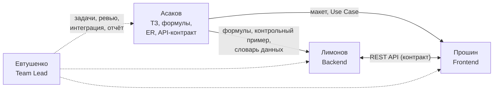
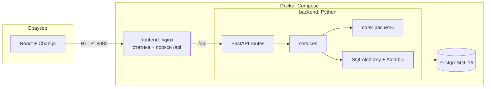
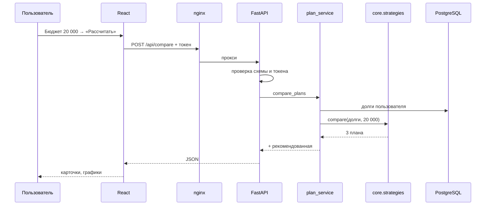

# Евтушенко — Team Lead

> Полная шпаргалка по **всему проекту** DebtFree. Тимлид должен уметь ответить на любой вопрос — про продукт, аналитику, архитектуру, backend, frontend, базу данных, безопасность, тесты, развёртывание и организацию работы команды.
>
> Как читать: раздел 1 — вступительная речь; раздел 2 — сценарий всей защиты (кто, что и в каком порядке говорит); разделы 3–14 — весь проект по частям; раздел 15 — большой список вопросов с ответами; раздел 16 — все цифры на одной странице; раздел 17 — словарь терминов.
>
> Подробные шпаргалки участников: [Асаков — аналитика и архитектура](Asakov_Analytics_Architecture.md) · [Лимонов — backend](Limonov_Backend.md) · [Прошин — frontend](Proshin_Frontend.md).

---

## Содержание

1. [Вступительная речь (3 минуты)](#1-вступительная-речь-3-минуты)
2. [Сценарий защиты](#2-сценарий-защиты)
3. [Команда и роли](#3-команда-и-роли)
4. [Как мы работали: этапы и процесс](#4-как-мы-работали-этапы-и-процесс)
5. [Продукт: что умеет DebtFree](#5-продукт-что-умеет-debtfree)
6. [Аналитика: ТЗ и бизнес-логика](#6-аналитика-тз-и-бизнес-логика)
7. [Проектирование: диаграммы](#7-проектирование-диаграммы)
8. [Архитектура](#8-архитектура)
9. [Backend](#9-backend)
10. [База данных](#10-база-данных)
11. [Frontend](#11-frontend)
12. [Безопасность](#12-безопасность)
13. [Качество: тестирование](#13-качество-тестирование)
14. [Развёртывание: Docker](#14-развёртывание-docker)
15. [Сложности, которые мы решили](#15-сложности-которые-мы-решили)
16. [Что можно развивать дальше](#16-что-можно-развивать-дальше)
17. [Вопросы комиссии и ответы](#17-вопросы-комиссии-и-ответы)
18. [Все цифры на одной странице](#18-все-цифры-на-одной-странице)
19. [Словарь терминов](#19-словарь-терминов)

---

## 1. Вступительная речь (3 минуты)

> «Здравствуйте. Наша команда — Евтушенко, Асаков, Прошин и Лимонов, группа ЭФБО-08-24 — представляет проект **DebtFree — планировщик погашения долгов**.
>
> **Проблема.** У многих людей одновременно несколько кредитов: кредитная карта, потребительский кредит, рассрочка. У каждого своя ставка, остаток и минимальный платёж. Если появляются свободные деньги, непонятно, на какой долг их направить и сколько в итоге придётся переплатить. Банковские калькуляторы считают только один кредит.
>
> **Решение.** DebtFree — веб-приложение, где пользователь вносит все свои долги и ежемесячный бюджет, а система:
> — считает аннуитетные и дифференцированные платежи и строит график по месяцам;
> — сравнивает три стратегии: **«Лавина»** — сначала самый дорогой долг, **«Снежный ком»** — сначала самый маленький, и **базовую** — только минимальные платежи;
> — показывает срок и переплату для каждой и рекомендует лучшую;
> — моделирует досрочное погашение — разовое или ежемесячное — с выбором: сократить срок или снизить платёж;
> — сохраняет расчёты как сценарии.
>
> **Результат на контрольном примере:** три долга на 290 тысяч. Если платить только минимумы — переплата 73 тысячи за 3 года. Лавина с бюджетом 20 тысяч — 33 тысячи за 17 месяцев. То есть правильная стратегия экономит **40 тысяч рублей**.
>
> **Технологии:** backend на Python и FastAPI, база PostgreSQL, интерфейс на React с графиками Chart.js. Всё упаковано в Docker и запускается одной командой. Деньги считаются через `Decimal` — с точностью до копейки. Написано **86 автотестов**, расчётный модуль покрыт на **99 %**, контрольный пример из отчёта совпадает до копейки.
>
> Дальше коллеги расскажут подробнее: Асаков — про аналитику и архитектуру, Лимонов — про серверную часть, Прошин — про интерфейс. После этого покажем приложение вживую».

---

## 2. Сценарий защиты

### 2.1. Порядок выступления (~15 минут)

| № | Кто | Тема | Время | Ключевые слайды / что показать |
|---|---|---|---|---|
| 1 | **Евтушенко** | Вступление: проблема, решение, результат, команда | 3 мин | Название, проблема, контрольный пример, стек |
| 2 | **Асаков** | Анализ, ТЗ, формулы, Use Case, BPMN, ER, архитектура | 4 мин | Таблица FR, формула аннуитета, Use Case, ER, компонентная диаграмма |
| 3 | **Лимонов** | Backend: слои, расчётный модуль, API, БД, безопасность, тесты | 3 мин | Структура `app/`, алгоритм стратегии, таблица API, вывод pytest |
| 4 | **Прошин** | Frontend: экраны, api.js, формы, графики, адаптивность | 2 мин | Карта экранов, ошибки в форме, телефонная ширина |
| 5 | **Прошин + Евтушенко** | **Живая демонстрация** | 3 мин | См. 2.2 |
| 6 | **Евтушенко** | Итоги, что дальше, вопросы | 1 мин | Выполнение критериев приёмки |

### 2.2. Демонстрация (по шагам)

Перед защитой: `docker compose up -d --build`, открыть http://localhost:8080, **заранее** проверить, что всё работает. На всякий случай — второй пользователь с уже внесёнными долгами.

1. **Регистрация** нового пользователя → пустой список «Долгов пока нет».
2. **Добавить 3 долга контрольного примера:**
   - Кредитная карта — 60 000 ₽, 29,9 %, мин. 3 000 ₽, 24 мес.
   - Потребительский кредит — 200 000 ₽, 15 %, мин. 7 000 ₽, 36 мес.
   - Рассрочка на телефон — 30 000 ₽, 0 %, мин. 3 000 ₽, 10 мес.
3. **Ошибка валидации:** у карты мин. платёж 1 000 → «Должен быть больше процентов за месяц (1 495 ₽)».
4. Итого: **290 000 ₽**, мин. платежи **13 000 ₽/мес**.
5. 📈 у потребительского кредита → платёж **6 933,07 ₽** (эталон T1).
6. Бюджет **12 000** → «Бюджет не может быть меньше суммы минимальных платежей» (T7).
7. Бюджет **20 000** → «Рассчитать план» → три карточки: Лавина **33 003 ₽** ★, Снежный ком **35 954 ₽**, Минимальные **73 067 ₽**.
8. «Открыть график» → досрочно **5 000 ₽, Каждый месяц, Сократить срок** → «Пересчитать» → **«Экономия 7 715 ₽, срок короче на 4 мес.»**, пунктирная линия.
9. «Сохранить сценарий» → «Лавина +5000» → «Сценарии» → открыть.
10. Попробовать удалить карту → **«Долг используется в сохранённых сценариях: «Лавина +5000»»**.
11. Сузить окно до ширины телефона — адаптивность.
12. (Если есть время) http://localhost:8080/docs — Swagger: «вот все 15 маршрутов API, их можно вызвать прямо отсюда».
13. (Если спросят про тесты) `docker compose --profile test run --rm tests` → **86 passed**.

### 2.3. Если что-то пошло не так

| Проблема | Что делать |
|---|---|
| Docker не запущен | Запустить Docker Desktop, подождать, `docker compose up -d` |
| Порт 8080 занят | В `.env` поставить `APP_PORT=8081`, `docker compose up -d` |
| backend unhealthy | `docker compose logs backend` — обычно неверный пароль БД или слабый `JWT_SECRET` |
| Всё сломалось | Показать скриншоты / запись демо, заранее подготовленные |

---

## 3. Команда и роли

| Участник | Роль | Зона ответственности |
|---|---|---|
| **Евтушенко** | Team Lead | Организация работы, репозиторий, README и отчёт, распределение задач, интеграция частей, контроль соответствия ТЗ, подготовка к защите |
| **Асаков** | Аналитика и Архитектура | Анализ предметной области, ТЗ (FR/NFR), формулы и алгоритмы, контрольный пример, Use Case, BPMN, ER и словарь данных, архитектура, проект API, план тестирования, макет |
| **Лимонов** | Backend | FastAPI, слои сервисов, расчётный модуль (`core`), модели и миграции БД, авторизация, ошибки на русском, автотесты, Docker-образ backend |
| **Прошин** | Frontend | React-приложение, 8 экранов, API-клиент, формы и валидация, графики Chart.js, адаптивная вёрстка, сборка и nginx |

### Как роли связаны между собой



**Ключевой момент:** аналитик заранее зафиксировал **контракт** — таблицу API, словарь данных и контрольный пример с готовыми цифрами. Поэтому backend и frontend могли работать параллельно, а правильность расчётов проверялась сравнением с заранее известным ответом.

---

## 4. Как мы работали: этапы и процесс

### 4.1. Этапы

| Этап | Что сделано | Артефакты |
|---|---|---|
| **1. Анализ** | Изучили предметную область, понятия, стратегии, существующие решения | Раздел 2 отчёта |
| **2. Техническое задание** | 9 FR, 5 NFR, роли, критерии приёмки, входы/выходы | Раздел 3 отчёта |
| **3. Бизнес-логика** | Формулы, алгоритм стратегий, правила досрочного, валидация, **контрольный пример** | Раздел 4 отчёта |
| **4. Проектирование** | Use Case, BPMN, ER + словарь, макет, архитектура, API, план тестов | README, `docs/erd.svg`, `docs/mockup.svg`, разделы 5–7 отчёта |
| **5. Реализация** | Backend (расчёты → API → БД), Frontend (экраны → графики) | `backend/`, `frontend/` |
| **6. Тестирование** | Тесты T1–T9 + API + миграции, сверка с контрольным примером | `backend/tests/` |
| **7. Упаковка** | Docker Compose, nginx, healthcheck, инструкция по запуску | `docker-compose.yml`, `DEPLOY.md` |

### 4.2. Принципы работы

- **Сначала проект, потом код.** Код писался строго по ТЗ и диаграммам; в комментариях кода есть ссылки на пункты ТЗ (FR-9, NFR-1, п. 4.4, T3…).
- **Контрольный пример как эталон.** Цифры посчитаны заранее, затем заложены в тесты — «готово» означает «тест зелёный».
- **Git.** Репозиторий на GitHub, основная ветка `main`; проектная документация велась в README и `docs/REPORT.md`.
- **Документация как часть продукта.** README (диаграммы), REPORT (ТЗ и логика), DEPLOY (запуск на другом компьютере), Swagger (`/docs`).
- **Отклонения фиксируются.** Всё, что уточнили при реализации (правило округления, поле `is_regular`, «снизить платёж» для нескольких долгов), записано в отчёт.

### 4.3. Структура репозитория

```text
DebtFree/
├── backend/            ← Лимонов: FastAPI, расчёты, БД, тесты
├── frontend/           ← Прошин: React, графики, nginx
├── docs/               ← Асаков: REPORT.md, erd.svg, mockup.svg
├── docker/postgres/    ← создание тестовой БД
├── docker-compose.yml  ← запуск всего одной командой
├── .env.example        ← шаблон секретов
├── README.md           ← описание + диаграммы
├── DEPLOY.md           ← инструкция по запуску
└── Reports/            ← шпаргалки к защите
```

---

## 5. Продукт: что умеет DebtFree

### 5.1. Функции

| № | Функция | Описание |
|---|---|---|
| F1 | Учёт долгов | Добавить / изменить / удалить: остаток, ставка, мин. платёж, срок, тип платежа, вид долга |
| F2 | Ежемесячные платежи | Аннуитетный и дифференцированный |
| F3 | График остатка | Помесячно: платёж, тело, проценты, остаток + линейный график |
| F4 | Сравнение стратегий | Лавина, Снежный ком, базовая; рекомендация лучшей |
| F5 | Переплата | Срок, сумма выплат, переплата по каждой стратегии |
| F6 | Досрочное погашение | Разово / ежемесячно, на конкретный долг или по стратегии; сократить срок / снизить платёж |
| F7 | Сценарии | Сохранить расчёт с графиком, посмотреть, удалить |

### 5.2. Экраны

| Экран | Адрес | Что делает |
|---|---|---|
| Вход / Регистрация | — | Две вкладки |
| Мои долги | `/debts` | Таблица, итоги, бюджет, переход к расчёту |
| Форма долга | `/debts/new`, `/debts/:id/edit` | Ввод и проверка |
| График долга | `/debts/:id/schedule` | График одного кредита + досрочный платёж |
| Сравнение | `/compare` | 3 карточки, диаграмма переплаты, графики, порядок закрытия |
| График | `/plan` | План по стратегии + досрочное погашение, экономия |
| Сценарии | `/scenarios` | Список сохранённых |
| Сценарий | `/scenarios/:id` | Детали, график, таблицы |

---

## 6. Аналитика: ТЗ и бизнес-логика

### 6.1. Требования

| ID | Функциональное требование |
|---|---|
| FR-1 | Регистрация и вход по email и паролю |
| FR-2 | CRUD долгов |
| FR-3 | Аннуитетный и дифференцированный платёж |
| FR-4 | Помесячный график и график остатка |
| FR-5 | Сравнение 3 стратегий при бюджете |
| FR-6 | Переплата и срок по стратегиям |
| FR-7 | Досрочное погашение |
| FR-8 | Сценарии |
| FR-9 | Валидация с понятными сообщениями |

| ID | Нефункциональное требование | Как выполнено |
|---|---|---|
| NFR-1 | 20 долгов × 50 лет < 2 с | Тест `test_nfr1_…` |
| NFR-2 | `decimal`, округление до копеек | Все деньги — `Decimal`, `NUMERIC(12,2)` в БД |
| NFR-3 | Пароли — только хеш | bcrypt с солью |
| NFR-4 | Экран от 360 px | Медиа-запросы 860 / 640 px |
| NFR-5 | Покрытие расчётов ≥ 80 % | Фактически 99 % |

### 6.2. Формулы

Обозначения: S — остаток, r — годовая ставка %, i = r / 12 / 100, n — месяцы.

| Что | Формула |
|---|---|
| Аннуитет | A = S · i / (1 − (1 + i)^(−n)); при i = 0: A = S / n |
| Дифференцированный | D = S / n; P_k = B_{k−1} · i; A_k = D + P_k |
| Переплата | Σ платежей − исходная сумма |

### 6.3. Алгоритм стратегий (каждый месяц)

1. Начислить проценты на каждый долг.
2. Свободная сумма = бюджет.
3. Заплатить минимальные платежи, вычесть их.
4. Добавить досрочные платежи этого месяца.
5. Отсортировать: **Лавина** — по ставке ↓, **Снежный ком** — по остатку ↑.
6. Направить свободную сумму на первый долг, затем на следующий.
7. Записать строку графика. Повторять, пока есть долги (не больше 600 мес.).

Для базовой стратегии шаги 5–6 пропускаются.

### 6.4. Досрочное погашение

- **Сократить срок** — бюджет прежний, деньги ускоряют погашение.
- **Снизить платёж** — для одного долга: пересчёт аннуитета на новый остаток и оставшийся срок; для нескольких: бинарным поиском подбирается минимальный бюджет (до копейки), при котором срок и переплата не хуже базового плана.

### 6.5. Контрольный пример

| Долг | Остаток | Ставка | Мин. платёж |
|---|---:|---:|---:|
| Кредитная карта | 60 000 | 29,9 % | 3 000 |
| Потребительский кредит | 200 000 | 15 % | 7 000 |
| Рассрочка | 30 000 | 0 % | 3 000 |

| Сценарий | Бюджет | Срок | Всего выплат | Переплата |
|---|---:|---:|---:|---:|
| Базовая | 13 000 | 36 | 363 066,92 | 73 066,92 |
| Снежный ком | 20 000 | 17 | 325 953,80 | 35 953,80 |
| Лавина | 20 000 | 17 | 323 002,56 | 33 002,56 |
| Лавина + 5 000/мес | 25 000 | 13 | 315 287,07 | 25 287,07 |

**Выводы:** Лавина дешевле Снежного кома на 2 951,24 ₽ и базовой на 40 064,36 ₽; +5 000 ₽/мес → −4 месяца и −7 715,49 ₽.

---

## 7. Проектирование: диаграммы

| Диаграмма | Где | Суть |
|---|---|---|
| **Use Case** | README, раздел 2 | 2 актёра (Гость, Пользователь), 18 вариантов в 4 блоках: аккаунт, учёт долгов, расчёты, досрочное и сценарии. Связи «include» (обязательно) и «extend» (по желанию) |
| **BPMN** | README, раздел 3 | Процесс от входа до сохранения сценария; 6 дорожек (Гость, Пользователь, Веб-интерфейс, REST API, Модуль расчётов, БД); 5 XOR-шлюзов |
| **ER** | `docs/erd.svg` | 7 таблиц, связи 1:N и M:N (через `scenario_debts`) |
| **Макет** | `docs/mockup.svg` | 4 основных экрана: список, форма, сравнение, график |
| **Компонентная** | README, раздел 6 | Браузер → nginx → FastAPI (API → сервисы → расчёты / ORM) → PostgreSQL |

### Include vs Extend — коротко

- **include** — базовый вариант **всегда** выполняет включаемый: «Добавить долг» → «Проверить корректность».
- **extend** — расширяющий вариант выполняется **иногда**: «Удалить долг» расширяет «Просмотреть список».

---

## 8. Архитектура



| Принцип | Реализация | Польза |
|---|---|---|
| Трёхзвенная архитектура | React / FastAPI / PostgreSQL | Независимое развитие частей |
| Слои backend | routes → services → core, models | Разделение ответственности |
| Изолированное ядро | `core` без БД и HTTP | 46 тестов за 0,1 с |
| REST + JSON | 15 маршрутов | Чёткий контракт frontend ↔ backend |
| Stateless-авторизация | JWT | Можно запускать несколько процессов |
| Одна точка входа | Наружу только nginx :8080 | БД и backend скрыты |
| Инфраструктура как код | Docker Compose, миграции | Запуск одной командой где угодно |

### Путь запроса «Сравнить стратегии»



---

## 9. Backend

**Стек:** Python 3.13, FastAPI, Pydantic, SQLAlchemy 2, Alembic, PostgreSQL 16, PyJWT, bcrypt, Uvicorn, pytest.

### 9.1. Слои

| Папка | Ответственность |
|---|---|
| `api/routes.py` | 15 маршрутов: принять → вызвать сервис → вернуть |
| `api/deps.py` | Сессия БД и текущий пользователь (Dependency Injection) |
| `api/errors.py` | Перевод ошибок на русский, формат `{detail, errors}` |
| `schemas/` | Pydantic: проверка входа, формат выхода |
| `services/` | auth, debt, plan, scenario: бизнес-логика, проверка владельца |
| `core/calculator.py` | Один долг: аннуитет, дифф., график, досрочные |
| `core/strategies.py` | Несколько долгов: 3 стратегии |
| `core/simulator.py` | Досрочное погашение, бинарный поиск бюджета |
| `models/` | 7 таблиц SQLAlchemy |
| `migrations/` | Alembic: схема + справочник стратегий |

### 9.2. API

| Метод | Путь | Назначение |
|---|---|---|
| POST | `/api/auth/register` | Регистрация (201 / 409) |
| POST | `/api/auth/login` | Вход → токен |
| GET | `/api/auth/me` | Текущий пользователь |
| GET | `/api/debts` | Долги + итоги |
| POST | `/api/debts` | Добавить |
| GET / PUT / DELETE | `/api/debts/{id}` | Один / изменить / удалить (409 если в сценарии) |
| POST | `/api/schedule` | График одного долга |
| POST | `/api/compare` | Сравнение стратегий |
| POST | `/api/early-payment` | Досрочное погашение |
| GET / POST | `/api/scenarios` | Список / сохранить |
| GET / DELETE | `/api/scenarios/{id}` | Детали / удалить |
| GET | `/api/health` | Сервер и БД живы? |

Swagger-документация генерируется автоматически: `/docs`.

### 9.3. Важные решения

- **`Decimal` везде** для денег; округление ROUND_HALF_UP до копеек.
- **Последний платёж закрывает остаток** — в конце ровно 0,00, тело = исходной сумме.
- **Сценарий пересчитывается на сервере**, клиент присылает только параметры.
- **Ошибки — на русском и с указанием поля**, чтобы фронтенд подсветил нужное.
- **Деньги в JSON — числом** (уже округлены), фронтенду не нужно парсить строки.

---

## 10. База данных

| Таблица | Содержимое | Связи |
|---|---|---|
| `users` | email (уникальный), хеш пароля | — |
| `debts` | параметры долга | → users (CASCADE) |
| `strategies` | справочник: avalanche, snowball, minimum | — |
| `scenarios` | бюджет, итоги, дата | → users (CASCADE), → strategies |
| `scenario_debts` | состав сценария (M:N) | → scenarios (CASCADE), → debts (RESTRICT) |
| `payment_schedule` | график сценария по месяцам и долгам | → scenarios (CASCADE), → debts (RESTRICT) |
| `extra_payments` | досрочные платежи сценария | → scenarios (CASCADE), → debts (RESTRICT, может быть NULL) |

- **CHECK** в `debts`: balance > 0, rate 0–100, min_payment > 0, term 1–600, payment_type ∈ {annuity, diff}.
- **3НФ**, кроме осознанного «снимка» итогов в `scenarios`.
- **Миграции Alembic**: применяются автоматически при старте backend; откатываются; тест проверяет, что модели = миграции.

---

## 11. Frontend

**Стек:** React 18, React Router 6, Chart.js 4, Vite 5, nginx.

| Модуль | Назначение |
|---|---|
| `main.jsx` | Маршруты; без входа показывается только экран входа |
| `api.js` | Все запросы: токен, ошибки, авто-выход при 401 |
| `context.jsx` | `AuthProvider` (пользователь), `PlanProvider` (бюджет и стратегия, в localStorage) |
| `format.js` | `323 002,56 ₽`, `29,9 %`, `17 мес. (1 г. 5 мес.)`; разбор «60 000,50» |
| `components/` | 12 переиспользуемых компонентов: поля, ошибки, таблицы, графики, формы |
| `pages/` | 8 экранов |

- **Двойная валидация:** мгновенно на клиенте + надёжно на сервере, сообщения одинаковые.
- **Графики:** линии остатка (до 3 стратегий или «база vs досрочно»), столбцы переплаты; единые цвета: Лавина — зелёная, Снежный ком — синий, Минимальные — красная.
- **Таблицы:** длинные графики сворачиваются до 12 строк.
- **Адаптивность:** ≤ 860 px и ≤ 640 px; от 360 px.
- **nginx:** SPA-фолбэк на index.html, прокси `/api`, gzip, кеш статики на год, заголовки безопасности.

---

## 12. Безопасность

| Угроза | Защита |
|---|---|
| Утечка БД | Пароли — bcrypt-хеш с солью |
| Подделка входа | JWT подписан секретом; в production секрет ≥ 32 символов, иначе backend не стартует |
| Доступ к чужим данным | Каждый запрос фильтруется по владельцу; на чужое — 404 |
| SQL-инъекции | Только ORM с параметрами |
| Некорректные данные | Pydantic + CHECK в БД + проверки в расчётах |
| Подбор email | Одно сообщение «Неверный email или пароль» |
| Длинные пароли bcrypt | Проверка длины в **байтах** (≤ 72) с понятной ошибкой |
| Прямой доступ к БД/backend | Наружу открыт только nginx |
| Clickjacking, MIME-sniffing | `X-Frame-Options: DENY`, `X-Content-Type-Options: nosniff` |
| Запуск от root | Backend работает от пользователя `app` |
| Утечка секретов | `.env` в `.gitignore`, шаблон `.env.example` |

---

## 13. Качество: тестирование

**86 автотестов** (64 функции, часть параметризована), все проходят.

| Файл | Что | Количество функций |
|---|---|---|
| `test_calculator.py` | Формулы одного долга | 14 |
| `test_strategies.py` | Стратегии и досрочное | 20 |
| `test_api.py` | Все маршруты, приватность, сценарии | 23 |
| `test_infra.py` | Миграции, health, настройки production | 7 |

| План | Результат |
|---|---|
| T1 Аннуитет = 6 933,07 | ✅ |
| T2 Ставка 0 % → S / n | ✅ |
| T3 Сумма тела = остатку | ✅ |
| T4 Остаток в конце = 0 | ✅ |
| T5 Контрольный пример | ✅ до копейки |
| T6 Лавина ≤ Снежный ком | ✅ (4 бюджета) |
| T7 Бюджет < минимумов → ошибка | ✅ |
| T8 Досрочный не ухудшает | ✅ (оба эффекта) |
| T9 Мин. платёж < процентов → ошибка | ✅ |
| NFR-1 20 долгов × 50 лет < 2 с | ✅ |
| NFR-5 Покрытие ≥ 80 % | ✅ 99 % расчётного модуля |

Тесты API работают на **отдельной базе** `debtfree_test` и применяют **настоящие миграции**.

```bash
docker compose --profile test run --rm tests    # → 86 passed
```

---

## 14. Развёртывание: Docker

### 14.1. Запуск

```bash
git clone https://github.com/NE4EL/DebtFree.git
cd DebtFree
cp .env.example .env          # вписать POSTGRES_PASSWORD и JWT_SECRET
docker compose up -d --build
# → http://localhost:8080          приложение
# → http://localhost:8080/docs     Swagger
# → http://localhost:8080/api/health
```

### 14.2. Контейнеры

| Контейнер | Что | Порт | Стартует после |
|---|---|---|---|
| `db` | PostgreSQL 16, данные в томе `pgdata` | внутренний | — |
| `backend` | FastAPI; при старте `alembic upgrade head` | внутренний 8000 | db healthy |
| `frontend` | nginx + сборка React | **8080** | backend healthy |
| `tests` | профиль `test`, pytest | — | db healthy |

- **Многоэтапные Dockerfile:** frontend собирается в Node, а в итоговом образе только nginx; backend имеет отдельную стадию для тестов.
- **Healthcheck** у всех сервисов, `restart: unless-stopped`.
- Подробная инструкция для другого компьютера, резервное копирование и решение проблем — в [DEPLOY.md](../DEPLOY.md).

---

## 15. Сложности, которые мы решили

Хорошая тема для защиты — показывает, что проект делали вдумчиво.

| Сложность | Решение |
|---|---|
| **Погрешности `float`** в денежных расчётах | Везде `Decimal`, в БД `NUMERIC(12,2)`, суммы с фронтенда — строкой |
| **«Хвосты» в копейку** в конце графика из-за округлений | Последний платёж закрывает весь остаток → в конце ровно 0,00 (T3, T4) |
| **Совпадение с контрольным примером** до копейки | Уточнили правило: в плане из нескольких долгов проценты не округляются помесячно, округляются строки графика и итоги; записали в отчёт |
| **«Снизить платёж» для нескольких долгов** — нет готовой формулы | Бинарный поиск минимального бюджета с точностью до копейки (~20 пересчётов) |
| **Долг, на который ссылается сценарий** | `ON DELETE RESTRICT` + понятная ошибка 409 со списком сценариев |
| **bcrypt учитывает только 72 байта**, кириллица — 2 байта на символ | Проверка длины в байтах и понятное сообщение |
| **Ошибки Pydantic по-английски** | Свой обработчик: перевод на русский + привязка к полю |
| **Обновление страницы на `/plan` давало 404** | nginx `try_files $uri /index.html` |
| **Перезапуск backend ломал прокси nginx** | `resolver 127.0.0.11` — DNS Docker при каждом запросе |
| **Бесконечный цикл**, если долг не гасится | Проверка «мин. платёж > процентов» + лимит 600 месяцев |
| **Слабый секрет в production** | Валидатор настроек: backend не стартует |
| **Модели и миграции могут разойтись** | Тест `test_models_match_migrations` |

---

## 16. Что можно развивать дальше

- Напоминания о платежах (email / push).
- Учёт дат: привязка графика к календарю по `start_date`.
- Экспорт графика в Excel / PDF.
- Сравнение двух сохранённых сценариев на одном графике.
- Комбинированные стратегии (например, сначала одна рассрочка, потом Лавина).
- Восстановление пароля по email, двухфакторная аутентификация.
- httpOnly-cookie вместо localStorage для токена.
- Тесты интерфейса (Playwright / Vitest), CI на GitHub Actions.
- HTTPS через обратный прокси (Caddy / Traefik) для публичного сервера.

---

## 17. Вопросы комиссии и ответы

### О проекте и команде

**— Чем ваш проект отличается от банковского калькулятора?**
Банковский считает один кредит. Мы работаем с несколькими долгами сразу, сравниваем стратегии распределения денег между ними, показываем экономию в рублях, моделируем досрочные платежи и сохраняем сценарии.

**— Кто что делал?**
Асаков — аналитика, ТЗ, формулы, диаграммы, архитектура. Лимонов — backend, расчёты, БД, тесты. Прошин — интерфейс, графики, nginx. Я — организация работы, репозиторий, документация, интеграция и контроль соответствия ТЗ.

**— Как вы организовали работу?**
Сначала полностью спроектировали: ТЗ, формулы, контрольный пример, ER, API. Это стало контрактом между участниками, поэтому backend и frontend делались параллельно. Готовность определялась тестами: контрольный пример должен совпасть до копейки.

**— Как вы проверяли, что всё соответствует ТЗ?**
Матрица трассировки: каждое FR и NFR привязано к Use Case, экрану, маршруту API и автотесту. Все 4 критерия приёмки подтверждены тестами.

**— Что было самым сложным?**
Точность расчётов: совпасть с контрольным примером до копейки, не получить «хвостов» от округлений и придумать, как «снизить платёж» в плане из нескольких долгов — там помог бинарный поиск.

### Предметная область

**— Почему Лавина выгоднее?**
Деньги идут на долг с самой высокой ставкой, поэтому меньше всего процентов начисляется в следующие месяцы. В примере — на 2 951 ₽ дешевле Снежного кома.

**— Зачем тогда Снежный ком?**
Психологически: быстро закрытые мелкие долги мотивируют продолжать. Мы показываем обе стратегии и разницу — человек решает сам.

**— Чем аннуитет отличается от дифференцированного?**
Аннуитет — одинаковый платёж каждый месяц, в начале в основном проценты. Дифференцированный — тело гасится равными частями, проценты на остаток, платёж уменьшается; переплата меньше, но первые платежи выше.

**— Что если минимальный платёж меньше процентов?**
Долг никогда не погасится. Система не даст сохранить такой долг и объяснит почему, указав сумму процентов.

### Технологии

**— Почему Python и FastAPI?**
Python — модуль `decimal` для точных денежных расчётов и простой код. FastAPI — быстрый, со встроенной валидацией и автоматической документацией Swagger.

**— Почему React?**
Компонентный подход: один компонент графика используется на 4 экранах. Самая распространённая библиотека, много документации.

**— Почему PostgreSQL?**
Точный тип NUMERIC для денег, CHECK-ограничения, транзакции, надёжность для многопользовательского режима.

**— Зачем Docker?**
Чтобы приложение одинаково запускалось на любом компьютере одной командой, без установки Python, Node и PostgreSQL.

**— Зачем nginx?**
Раздаёт собранный React, проксирует `/api` на backend (одинаковый адрес → не нужен CORS), сжимает ответы, кеширует статику, добавляет заголовки безопасности. Это единственный открытый наружу контейнер.

**— Что такое миграции?**
Версии схемы БД в виде кода. Backend при старте сам приводит базу к актуальной версии; изменения можно откатить.

### Расчёты и качество

**— Почему Decimal, а не float?**
`0.1 + 0.2` во float — `0.30000000000000004`. За сотни месяцев ошибки накапливаются. Decimal считает точно, как бухгалтер.

**— Как вы проверили правильность?**
Эталонное значение аннуитета (6 933,07 ₽), полный контрольный пример с 4 сценариями, инварианты (сумма тела = долгу, остаток в конце 0, Лавина ≤ Снежный ком) — всё автотестами.

**— Сколько тестов и какое покрытие?**
86 тестов, все проходят. Расчётный модуль покрыт на 99 % при требовании 80 %.

**— Какая производительность?**
20 долгов на 50 лет — меньше 2 секунд (NFR-1), это проверяет отдельный тест. Обычный расчёт — мгновенный.

**— Как работает «снизить платёж» для нескольких долгов?**
Бинарный поиск: между суммой минимальных платежей и текущим бюджетом ищем минимальный бюджет с точностью до копейки, при котором срок и переплата не хуже, чем без досрочного платежа. ~20 пересчётов.

### Безопасность

**— Как хранятся пароли?**
Только bcrypt-хеш с уникальной солью. Сам пароль нигде не хранится.

**— Как работает авторизация?**
После входа сервер выдаёт JWT-токен на 24 часа, подписанный секретом. Фронтенд шлёт его в заголовке `Authorization: Bearer`. Сервер проверяет подпись и срок.

**— Может ли один пользователь увидеть данные другого?**
Нет: каждый запрос проверяет владельца, на чужой id возвращается 404. Это покрыто тестами.

**— Почему токен в localStorage, это безопасно?**
Для учебного проекта — приемлемо: React экранирует вывод, «сырого» HTML нет, токен живёт 24 часа. Для продакшена можно перейти на httpOnly-cookie — это в планах развития.

### Данные

**— Какие связи в БД?**
Пользователь 1:N долги и сценарии; стратегия 1:N сценарии; сценарий M:N долги через `scenario_debts`; сценарий 1:N строки графика и досрочные платежи.

**— Почему нельзя удалить долг из сценария?**
Сценарий потеряет часть графика. В БД стоит RESTRICT, а API возвращает 409 с названиями сценариев.

**— Зачем хранить график сценария, если можно пересчитать?**
Сценарий — снимок на момент сохранения. Если долг потом изменят, сценарий покажет исходные цифры.

---

## 18. Все цифры на одной странице

| Что | Значение |
|---|---|
| Участников | 4 |
| Функциональных требований | 9 |
| Нефункциональных | 5 |
| Use Case | 18 в 4 блоках, 2 актёра |
| BPMN | 6 дорожек, 5 шлюзов |
| Таблиц БД | 7 |
| Маршрутов API | 15 + health |
| Экранов | 8 |
| Компонентов UI | 12 |
| Контейнеров | 3 (+ tests) |
| Автотестов | 86 (64 функции) |
| Покрытие расчётного модуля | 99 % |
| Строк кода backend / тестов / frontend | ~1 600 / ~680 / ~2 100 |
| Макс. срок | 600 мес. (50 лет) |
| NFR-1 | 20 долгов × 50 лет < 2 с |
| Пароль | 8 символов … 72 байта |
| Токен | 24 часа, секрет ≥ 32 символов в production |
| Порт | 8080 (dev: 5173 и 8000) |
| T1 | 200 000 ₽ / 15 % / 36 мес. → **6 933,07 ₽** |
| Пример: долг / минимумы | 290 000 ₽ / 13 000 ₽ в месяц |
| Базовая | 36 мес., переплата **73 066,92 ₽** |
| Снежный ком (20 000) | 17 мес., **35 953,80 ₽** |
| Лавина (20 000) | 17 мес., **33 002,56 ₽** |
| Лавина + 5 000/мес | 13 мес., **25 287,07 ₽** |
| Лавина vs Снежный ком | −2 951,24 ₽ |
| Лавина vs Базовая | −40 064,36 ₽ |
| Эффект +5 000/мес | −4 мес., −7 715,49 ₽ |

---

## 19. Словарь терминов

| Термин | Объяснение |
|---|---|
| **API** | Программный интерфейс: набор адресов, через которые фронтенд общается с сервером |
| **REST** | Стиль API: ресурсы по адресам + HTTP-методы GET/POST/PUT/DELETE |
| **JSON** | Текстовый формат обмена данными `{"budget": 20000}` |
| **SPA** | Одностраничное приложение: перерисовываются части страницы без перезагрузки |
| **ORM** | Работа с таблицами БД как с классами в коде |
| **Миграция** | Версия схемы БД в виде кода, которую можно применить или откатить |
| **JWT** | Подписанный токен с id пользователя и сроком действия |
| **bcrypt** | Медленный алгоритм хеширования паролей с солью |
| **Хеш** | Необратимое преобразование: из хеша нельзя получить пароль |
| **Соль** | Случайная добавка к паролю перед хешированием, у каждого своя |
| **Dependency Injection** | Функция получает нужные ресурсы (сессию БД, пользователя) извне |
| **Pydantic** | Библиотека проверки данных по описанию типов |
| **Healthcheck** | Регулярная проверка, что сервис жив |
| **Docker Compose** | Запуск нескольких контейнеров одной командой по описанию в YAML |
| **Прокси** | Сервер-посредник: nginx принимает `/api` и передаёт на backend |
| **CORS** | Ограничение браузера на запросы к другому домену; у нас не нужно — всё на одном адресе |
| **Use Case** | UML-диаграмма: кто и что может делать в системе |
| **BPMN** | Нотация бизнес-процессов: задачи, события, шлюзы, дорожки |
| **ER-диаграмма** | Сущности (таблицы) и связи между ними |
| **3НФ** | Третья нормальная форма: нет повторов и транзитивных зависимостей |
| **CHECK** | Ограничение в БД: значение должно удовлетворять условию |
| **CASCADE / RESTRICT** | При удалении родителя: удалить детей / запретить удаление |
| **Покрытие тестами** | Доля строк кода, выполненных во время тестов |
| **Бинарный поиск** | Поиск значения делением интервала пополам |
| **Аннуитет** | Равный ежемесячный платёж |
| **Лавина / Снежный ком** | Стратегии: сначала самый дорогой / самый маленький долг |
