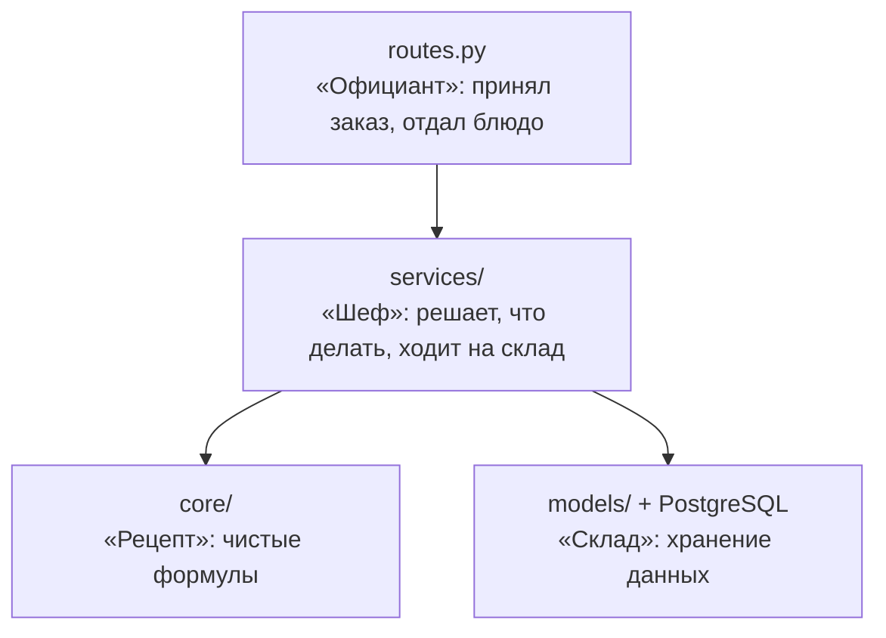
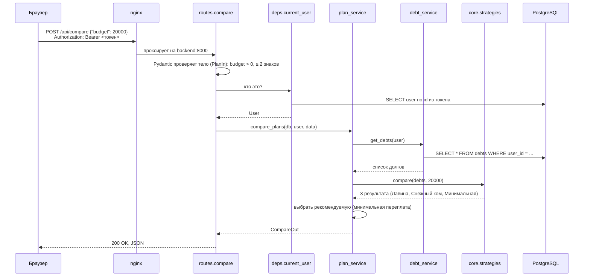

# Лимонов — Backend

> Шпаргалка для защиты. Роль: **серверная часть** — API на FastAPI, база данных PostgreSQL, расчётный модуль на Python, авторизация, миграции, тесты, Docker-образ backend.
>
> Как читать: сначала раздел 1 (рассказ на 2 минуты), потом разделы 2–9 (детали, если спросят), в конце — раздел 10 с готовыми ответами на вопросы комиссии.

---

## Содержание

1. [Рассказ на 2 минуты](#1-рассказ-на-2-минуты)
2. [Стек и почему именно он](#2-стек-и-почему-именно-он)
3. [Структура backend: слои](#3-структура-backend-слои)
4. [Путь одного запроса от начала до конца](#4-путь-одного-запроса-от-начала-до-конца)
5. [Расчётный модуль — сердце проекта](#5-расчётный-модуль--сердце-проекта)
6. [База данных, модели и миграции](#6-база-данных-модели-и-миграции)
7. [REST API](#7-rest-api)
8. [Безопасность и ошибки](#8-безопасность-и-ошибки)
9. [Тесты и Docker](#9-тесты-и-docker)
10. [Вопросы комиссии и ответы](#10-вопросы-комиссии-и-ответы)
11. [Шпаргалка цифр](#11-шпаргалка-цифр)

---

## 1. Рассказ на 2 минуты

> «Я отвечал за серверную часть DebtFree. Backend написан на **Python и FastAPI**, данные хранятся в **PostgreSQL**, доступ к БД — через **SQLAlchemy**, схема создаётся **миграциями Alembic**.
>
> Код разделён на слои: **маршруты API** только принимают запрос и отдают ответ; **сервисы** содержат бизнес-логику и работу с БД; **расчётный модуль** (`core`) — это чистая математика, он вообще не знает про базу и HTTP. Благодаря этому расчёты можно тестировать отдельно и быстро.
>
> Расчётный модуль умеет: считать аннуитетный и дифференцированный платёж, строить помесячный график, моделировать три стратегии погашения нескольких долгов — «Лавину», «Снежный ком» и «только минимальные платежи», — и считать эффект досрочного платежа: сократить срок или снизить платёж. Все деньги считаются через `Decimal`, а не `float`, чтобы не терять копейки.
>
> Пароли хранятся как хеш **bcrypt**, вход — по **JWT-токену**. Каждый пользователь видит только свои долги и сценарии. Ошибки возвращаются на русском языке с указанием поля.
>
> Всё покрыто тестами на **pytest**: 86 проверок, включая контрольный пример из отчёта — наши цифры совпадают с ним до копейки. Backend упакован в Docker и при старте сам применяет миграции».

---

## 2. Стек и почему именно он

| Технология | Версия | Зачем | Почему выбрали |
|---|---|---|---|
| **Python** | 3.13 (в Docker), 3.11+ локально | Язык backend | Модуль `decimal` для точных денежных расчётов, простой синтаксис, требование ТЗ |
| **FastAPI** | 0.120 | Веб-фреймворк, REST API | Быстрый, сам генерирует документацию Swagger (`/docs`), встроенная валидация через Pydantic |
| **Pydantic** | 2.12 | Схемы запросов/ответов, валидация | Описываешь поле один раз — получаешь проверку типа, диапазона и сообщение об ошибке |
| **SQLAlchemy** | 2.0 | ORM — работа с БД через Python-классы | Не пишем SQL руками, защищает от SQL-инъекций |
| **Alembic** | 1.17 | Миграции схемы БД | Схема БД версионируется как код, можно откатить |
| **PostgreSQL** | 16 | СУБД | Надёжная, поддерживает тип `NUMERIC` для денег, CHECK-ограничения |
| **psycopg** | 3.2 | Драйвер PostgreSQL | Современный драйвер для SQLAlchemy 2 |
| **PyJWT** | 2.10 | Токены входа | Стандарт JWT, без хранения сессий на сервере |
| **bcrypt** | 5.0 | Хеширование паролей | Медленный по задумке алгоритм с «солью» — устойчив к подбору |
| **Uvicorn** | 0.38 | ASGI-сервер, запускает FastAPI | Стандартный сервер для FastAPI |
| **pytest / pytest-cov / httpx** | 8.4 / 7.0 / 0.28 | Тесты и покрытие | Простые тесты, `TestClient` FastAPI работает на httpx |

Зависимости зафиксированы с точными версиями в [backend/requirements.txt](../backend/requirements.txt) и [backend/requirements-dev.txt](../backend/requirements-dev.txt) — сборка воспроизводима.

---

## 3. Структура backend: слои

```text
backend/
├── app/
│   ├── main.py            ← создание приложения FastAPI, CORS, /api/health
│   ├── config.py          ← настройки из переменных окружения (.env)
│   ├── db.py              ← подключение к БД, сессии
│   ├── api/
│   │   ├── routes.py      ← 15 маршрутов REST API
│   │   ├── deps.py        ← зависимости: сессия БД, текущий пользователь
│   │   └── errors.py      ← перевод ошибок на русский (FR-9)
│   ├── schemas/           ← Pydantic-схемы: что приходит и что уходит
│   ├── services/          ← бизнес-логика: auth, debt, plan, scenario
│   ├── core/              ← ЧИСТАЯ МАТЕМАТИКА (без БД и HTTP)
│   │   ├── calculator.py  ← один долг: аннуитет, дифф., график
│   │   ├── strategies.py  ← несколько долгов: Лавина, Снежный ком, базовая
│   │   └── simulator.py   ← досрочное погашение
│   └── models/            ← SQLAlchemy-модели (таблицы)
├── migrations/            ← Alembic: создание таблиц + справочник стратегий
├── tests/                 ← 4 файла тестов
└── Dockerfile
```

### Слои простыми словами



| Слой | Что делает | Чего НЕ делает |
|---|---|---|
| **routes** ([routes.py](../backend/app/api/routes.py)) | Описывает URL, метод, схему входа/выхода, требует авторизацию | Не считает и не лезет в БД напрямую |
| **schemas** ([schemas/](../backend/app/schemas/__init__.py)) | Проверяет входные данные, форматирует выход | Не знает про БД |
| **services** ([services/](../backend/app/services/)) | Загружает долги пользователя, вызывает расчёт, сохраняет сценарии, проверяет «чьё это» | Не содержит формул |
| **core** ([core/](../backend/app/core/)) | Формулы и алгоритмы | Ничего не знает о БД, HTTP, пользователях |
| **models** ([models/](../backend/app/models/__init__.py)) | Описание таблиц | Логики нет |

**Почему это важно (говорить на защите):** расчётный модуль можно проверить тестами за доли секунды без базы данных; формулы можно поменять, не трогая API; API можно поменять, не трогая формулы.

---

## 4. Путь одного запроса от начала до конца

Пример: пользователь нажал «Рассчитать» на экране «Сравнение» с бюджетом 20 000 ₽.



Код маршрута — буквально три строки ([routes.py](../backend/app/api/routes.py)):

```python
@router.post("/compare", response_model=CompareOut, tags=["calculations"])
def compare(data: PlanIn, db: DB, user: CurrentUser):
    return plan_service.compare_plans(db, user, data)
```

- `data: PlanIn` — FastAPI сам распарсит JSON и проверит его схемой.
- `db: DB` — FastAPI сам откроет сессию БД и закроет её после ответа (`Depends(get_db)`).
- `user: CurrentUser` — FastAPI сам проверит токен; если его нет — вернёт 401.

Это называется **Dependency Injection** (внедрение зависимостей) — маршрут не создаёт ресурсы сам, их «подают» ему.

---

## 5. Расчётный модуль — сердце проекта

Обозначения: **S** — остаток долга, **r** — годовая ставка в %, **i = r / 12 / 100** — месячная ставка, **n** — срок в месяцах.

### 5.1. Почему `Decimal`, а не `float`

```python
>>> 0.1 + 0.2
0.30000000000000004        # float — ошибка в 17-м знаке
>>> Decimal("0.1") + Decimal("0.2")
Decimal('0.3')             # Decimal — точно
```

За 600 месяцев ошибки `float` накапливаются, и итог может разойтись на копейки. Поэтому **все деньги — `Decimal`**, округление — функцией `to_money()` до копеек по правилу **ROUND_HALF_UP** (как в школе: 0,005 → 0,01). Это требование **NFR-2**.

```python
CENT = Decimal("0.01")
def to_money(value): return Decimal(value).quantize(CENT, rounding=ROUND_HALF_UP)
```

### 5.2. Аннуитетный платёж (равные платежи)

```text
A = S · i / (1 − (1 + i)^(−n)),   если ставка 0 %:  A = S / n
```

```python
def annuity_payment(balance, annual_rate, months):
    i = monthly_rate(annual_rate)          # r / 1200
    if i == 0:
        return to_money(balance / months)
    return to_money(balance * i / (1 - (1 + i) ** -months))
```

**Проверка (тест T1):** 200 000 ₽, 15 %, 36 мес. → i = 0,0125 → **6 933,07 ₽**.

Каждый месяц: проценты = остаток × i, основной долг = платёж − проценты, остаток уменьшается на основной долг. В начале доля процентов большая, к концу — маленькая.

### 5.3. Дифференцированный платёж (убывающие платежи)

```text
D = S / n             — основной долг каждый месяц одинаковый
P_k = остаток · i     — проценты на текущий остаток
Платёж_k = D + P_k    — платёж уменьшается каждый месяц
```

**Пример из теста:** 120 000 ₽, 12 %, 12 мес. → D = 10 000; первый платёж 11 200, последний 10 100, переплата 7 800.

### 5.4. График одного долга — `build_schedule()` ([calculator.py](../backend/app/core/calculator.py))

Цикл «пока остаток > 0»:

1. Проценты месяца = округлить(остаток × i).
2. Основной долг = (аннуитет − проценты) или D (для дифф.).
3. **Если это последний месяц или основной долг ≥ остатка → основной долг = весь остаток.** Это гарантирует, что в конце остаток ровно 0,00, а сумма основного долга равна исходной сумме (тесты **T3, T4**). Без этого из-за округлений оставались бы «хвосты» в несколько копеек.
4. Применить досрочные платежи этого месяца.
5. Если эффект «снизить платёж» — пересчитать аннуитет на новый остаток и **оставшийся** срок.

### 5.5. Стратегии для нескольких долгов — `simulate()` ([strategies.py](../backend/app/core/strategies.py))

| Стратегия | Куда идут свободные деньги | Порядок сортировки (`_priority`) |
|---|---|---|
| **Лавина** (avalanche) | На долг с **наибольшей ставкой** | по убыванию ставки, при равенстве — по остатку |
| **Снежный ком** (snowball) | На долг с **наименьшим остатком** | по возрастанию остатка, при равенстве — по ставке |
| **Базовая** (minimum) | Никуда — только минимальные платежи | бюджет = сумма минимальных платежей |

Алгоритм одного месяца:

```text
1. Начислить проценты на каждый долг:      остаток += остаток · i
2. Свободная сумма = бюджет
3. Заплатить минимальный платёж по каждому долгу (не больше остатка),
   вычесть из свободной суммы
4. Добавить досрочные платежи этого месяца
5. Отсортировать долги по правилу стратегии
6. Отдать свободную сумму первому долгу, остаток — следующему и т.д.
7. Записать строку графика
Повторять, пока есть долги с остатком > 0 (не больше 600 месяцев)
```

**Разбор первого месяца на контрольном примере (Лавина, бюджет 20 000):**

| Шаг | Карта (29,9 %) | Кредит (15 %) | Рассрочка (0 %) | Свободно |
|---|---:|---:|---:|---:|
| Остаток на начало | 60 000 | 200 000 | 30 000 | 20 000 |
| + проценты | +1 495 | +2 500 | +0 | |
| − мин. платёж | −3 000 | −7 000 | −3 000 | 20 000 − 13 000 = **7 000** |
| Лавина: 7 000 → на карту (самая высокая ставка) | −7 000 | | | 0 |
| **Остаток на конец** | **51 495** | **195 500** | **27 000** | |

Итого за месяц заплачено 20 000, из них проценты 3 995, тело 16 005. Общий остаток 273 995 = 290 000 − 16 005 ✓.

При «Снежном коме» те же 7 000 пошли бы на **рассрочку** (у неё самый маленький остаток 27 000).

**Важная деталь:** здесь проценты **не округляются** каждый месяц внутри цикла (в отличие от графика одного долга), округляются только строки графика и итоги. Именно так получаются цифры контрольного примера 4.7 в отчёте — это было уточнено при реализации и записано в отчёте (раздел 6).

### 5.6. Досрочное погашение — `early_payment()` ([simulator.py](../backend/app/core/simulator.py))

Считаются **два плана**: без досрочного платежа (`base`) и с ним (`with_extra`). Разница — это экономия.

| Эффект | Как работает в плане из нескольких долгов |
|---|---|
| **Сократить срок** (`term`) | Бюджет прежний, досрочные деньги добавляются → долги закрываются раньше |
| **Снизить платёж** (`payment`) | Подбирается **минимальный ежемесячный бюджет** (с точностью до копейки), при котором срок и переплата **не хуже**, чем без досрочного платежа |

Как подбирается бюджет — **бинарный поиск** (`_lowest_budget_not_worse`):

```text
нижняя граница = сумма минимальных платежей
верхняя граница = текущий бюджет
пока границы не сошлись до 1 копейки:
    середина → смоделировать план
    если план не хуже базового → двигаем верхнюю границу вниз
    иначе → двигаем нижнюю вверх
```

Это ~20 итераций вместо перебора сотен тысяч копеек. Тест проверяет, что на копейку меньше — план уже хуже.

Досрочный платёж может быть:
- **разовый** (в месяце N) или **регулярный** (каждый месяц начиная с N);
- **на конкретный долг** (`debt_id`) или **без долга** — тогда он добавляется к свободной сумме и распределяется по правилу стратегии.

### 5.7. Проверки внутри расчётов (`CalculationError`)

| Проверка | Сообщение |
|---|---|
| Нет долгов | «Добавьте хотя бы один долг» |
| Бюджет < суммы мин. платежей (T7) | «Бюджет не может быть меньше суммы минимальных платежей (13000.00 ₽)» |
| Мин. платёж ≤ процентов за месяц (T9) | «…минимальный платёж не покрывает начисленные за месяц проценты — долг не погашается» |
| Не погашается за 50 лет | «Долги не погашаются за 50 лет — увеличьте бюджет» |
| Разовый досрочный платёж больше остатка | «Досрочный платёж в месяце N больше остатка долга…» |
| «Снизить платёж» для базовой стратегии | «Для базовой стратегии ежемесячный платёж фиксирован — выберите «Сократить срок»» |

---

## 6. База данных, модели и миграции

### 6.1. Таблицы (7 штук)

| Таблица | Что хранит | Ключевые поля |
|---|---|---|
| `users` | Пользователи | `email` (уникальный), `password_hash` |
| `debts` | Долги | `user_id`, `balance`, `annual_rate`, `min_payment`, `term_months`, `payment_type` |
| `strategies` | Справочник стратегий | `code`: avalanche / snowball / minimum |
| `scenarios` | Сохранённые расчёты | `user_id`, `strategy_id`, `monthly_budget`, итоги |
| `scenario_debts` | Какие долги входят в сценарий (M:N) | составной PK (`scenario_id`, `debt_id`) |
| `payment_schedule` | Помесячный график сценария | `month_no`, `payment`, `principal_part`, `interest_part`, `balance_after` |
| `extra_payments` | Досрочные платежи сценария | `amount`, `pay_month`, `effect`, `is_regular`, `debt_id` (может быть NULL) |

### 6.2. Защита данных на уровне БД

**CHECK-ограничения** на таблице `debts` — даже если кто-то обойдёт API, база не примет мусор:

```python
CheckConstraint("balance > 0")
CheckConstraint("annual_rate BETWEEN 0 AND 100")
CheckConstraint("min_payment > 0")
CheckConstraint("term_months BETWEEN 1 AND 600")
CheckConstraint("payment_type IN ('annuity', 'diff')")
```

**Каскады удаления** (`ondelete`):

| Связь | Правило | Смысл |
|---|---|---|
| debts → users | `CASCADE` | Удалили пользователя — удалились его долги |
| scenarios → users | `CASCADE` | То же для сценариев |
| payment_schedule / extra_payments / scenario_debts → scenarios | `CASCADE` | Удалили сценарий — удалился его график |
| payment_schedule / extra_payments / scenario_debts → debts | `RESTRICT` | **Нельзя удалить долг, пока он в сценарии** |

Плюс сервис `delete_debt` заранее проверяет это и возвращает понятную ошибку **409 Conflict**: «Долг используется в сохранённых сценариях: «Лавина +5000». Сначала удалите их».

**Деньги — тип `NUMERIC(12,2)`** (до 9 999 999 999,99 ₽, ровно 2 знака). Для итогов сценария — `NUMERIC(14,2)`.

**Индексы** на `user_id` и `scenario_id` — быстрый поиск «все долги пользователя».

### 6.3. Миграции Alembic

- Файл [0001_initial_schema.py](../backend/migrations/versions/0001_initial_schema.py) создаёт все 7 таблиц и **заполняет справочник стратегий** (3 строки).
- `downgrade()` удаляет всё в обратном порядке — миграцию можно откатить.
- URL базы берётся из настроек приложения ([migrations/env.py](../backend/migrations/env.py)), а не прописан в `alembic.ini`.
- В Docker миграции применяются **автоматически при каждом старте** backend: `alembic upgrade head && uvicorn ...`.
- Тест `test_models_match_migrations` проверяет, что модели в коде и миграции **не расходятся** (autogenerate не находит изменений).

**Почему миграции, а не `Base.metadata.create_all()`:** `create_all` не умеет изменять существующие таблицы. Миграции — это история изменений схемы, её можно применить на любой машине и откатить.

---

## 7. REST API

Все пути начинаются с `/api`. Документация Swagger доступна на `/docs`.

| Метод | Путь | Что делает | Ответ |
|---|---|---|---|
| POST | `/auth/register` | Регистрация | 201 + пользователь / 409 если email занят |
| POST | `/auth/login` | Вход | 200 + `access_token` / 401 |
| GET | `/auth/me` | Кто я | 200 / 401 |
| GET | `/debts` | Список долгов + общий остаток + сумма мин. платежей | 200 |
| POST | `/debts` | Добавить долг | 201 / 422 |
| GET | `/debts/{id}` | Один долг | 200 / 404 |
| PUT | `/debts/{id}` | Изменить | 200 / 404 / 422 |
| DELETE | `/debts/{id}` | Удалить | 204 / 404 / 409 |
| POST | `/schedule` | График одного долга (по `debt_id` или по параметрам) | 200 |
| POST | `/compare` | Сравнить 3 стратегии при бюджете | 200 / 422 |
| POST | `/early-payment` | План с досрочным платежом vs без | 200 / 422 |
| GET | `/scenarios` | Список сценариев | 200 |
| POST | `/scenarios` | Сохранить сценарий (пересчитывается на сервере!) | 201 |
| GET | `/scenarios/{id}` | Сценарий с графиком | 200 / 404 |
| DELETE | `/scenarios/{id}` | Удалить сценарий | 204 / 404 |
| GET | `/health` | Проверка: жив ли сервер и БД | 200 / 503 |

### Коды ответов — что значат

| Код | Когда |
|---|---|
| 200 / 201 / 204 | Успех / создано / удалено (без тела) |
| 401 | Нет токена или он истёк |
| 404 | Не найдено **или чужое** (не раскрываем, что такой id существует) |
| 409 | Конфликт: email занят, долг в сценарии |
| 422 | Ошибка валидации или расчёта |
| 503 | База данных недоступна (health) |

### Пример запроса и ответа

```http
POST /api/compare
Authorization: Bearer eyJhbGciOi...
Content-Type: application/json

{ "budget": 20000 }
```

```json
{
  "budget": 20000.0,
  "total_balance": 290000.0,
  "total_min_payments": 13000.0,
  "recommended": "avalanche",
  "results": [
    { "strategy": "avalanche", "strategy_name": "Лавина", "months": 17,
      "total_paid": 323002.56, "total_interest": 33002.56, "timeline": [...], "debts": [...] },
    ...
  ]
}
```

**Интересное решение:** внутри деньги — `Decimal`, а в JSON отдаются **числом** (`PlainSerializer(float)`), чтобы фронтенду не нужно было парсить строки. Точность при этом не теряется, т.к. значения уже округлены до копеек.

**Сценарий пересчитывается на сервере.** Клиент присылает только параметры (бюджет, стратегия, досрочные платежи), а результат backend считает сам. Так нельзя подсунуть в базу «нарисованные» цифры.

---

## 8. Безопасность и ошибки

### 8.1. Пароли (NFR-3)

```python
def hash_password(password):  return bcrypt.hashpw(password.encode(), bcrypt.gensalt()).decode()
def verify_password(p, h):    return bcrypt.checkpw(p.encode(), h.encode())
```

- В базе хранится только хеш (тест `test_password_is_stored_hashed`).
- У каждого пароля своя случайная **соль** — одинаковые пароли дают разные хеши.
- bcrypt учитывает только первые **72 байта**. Кириллица — 2 байта на символ, поэтому мы отдельно проверяем длину **в байтах** и даём понятную ошибку, а не молча обрезаем пароль.
- Минимальная длина пароля — 8 символов. Email приводится к нижнему регистру.

### 8.2. JWT-токен

```python
payload = {"sub": str(user.id), "exp": now + 24 часа}
token = jwt.encode(payload, JWT_SECRET, algorithm="HS256")
```

- Токен подписан секретом сервера — подделать его без секрета нельзя.
- Срок жизни — 24 часа (`JWT_EXPIRE_MINUTES=1440`).
- Клиент шлёт заголовок `Authorization: Bearer <токен>`.
- **В production backend не запустится**, если `JWT_SECRET` стандартный или короче 32 символов (валидатор в [config.py](../backend/app/config.py), тест `test_production_requires_strong_secret`).
- При неверном пароле сообщение одинаковое — «Неверный email или пароль» — не подсказываем, какой email существует.

### 8.3. Изоляция данных пользователей

Каждая выборка фильтруется по владельцу:

```python
def get_debt(db, user, debt_id):
    debt = db.get(Debt, debt_id)
    if debt is None or debt.user_id != user.id:
        raise NotFound("Долг не найден")
```

Тесты `test_debts_are_private`, `test_scenario_is_private`, `test_early_payment_extra_for_foreign_debt` проверяют, что чужой долг/сценарий даёт 404.

### 8.4. Понятные ошибки на русском (FR-9) — [errors.py](../backend/app/api/errors.py)

Pydantic по умолчанию отвечает по-английски («Input should be greater than 0»). Мы перехватываем все ошибки и переводим:

| Было (Pydantic) | Стало |
|---|---|
| `greater_than` для `balance` | «Остаток: должно быть больше 0» |
| `less_than_equal` для `annual_rate` | «Ставка: должно быть не больше 100» |
| `decimal_parsing` | «Остаток: введите число» |
| `decimal_max_places` | «Остаток: не больше 2 знаков после запятой» |
| `literal_error` | «Тип платежа: недопустимое значение» |

Формат ответа об ошибке:

```json
{
  "detail": "Остаток: должно быть больше 0",
  "errors": [{ "field": "balance", "message": "Остаток: должно быть больше 0" }]
}
```

`detail` — для общего сообщения, `errors[].field` — чтобы фронтенд подсветил конкретное поле.

Иерархия исключений сервисов ([services/\_\_init\_\_.py](../backend/app/services/__init__.py)):

```python
class ServiceError(Exception):  status_code = 400
class NotFound(ServiceError):   status_code = 404
class Conflict(ServiceError):   status_code = 409
class Unauthorized(ServiceError): status_code = 401
```

Сервис просто бросает `raise NotFound("Долг не найден")`, а общий обработчик превращает это в нужный HTTP-ответ.

### 8.5. Прочее

- **SQL-инъекции** невозможны: все запросы через ORM с параметрами.
- **CORS** в Docker отключён (`CORS_ORIGINS=[]`): фронтенд и API на одном адресе.
- Swagger можно выключить в production: `DOCS_ENABLED=false`.
- Контейнер backend работает **не от root** (пользователь `app`, uid 10001).

---

## 9. Тесты и Docker

### 9.1. Тесты — 86 проверок (64 функции, часть параметризована)

| Файл | Что проверяет | Нужна БД? |
|---|---|---|
| [test_calculator.py](../backend/tests/test_calculator.py) | Формулы одного долга: T1–T4, досрочные, валидация | Нет |
| [test_strategies.py](../backend/tests/test_strategies.py) | Стратегии и досрочное: T5–T9, NFR-1 (скорость) | Нет |
| [test_api.py](../backend/tests/test_api.py) | Все маршруты: регистрация, CRUD, приватность, сценарии | Да |
| [test_infra.py](../backend/tests/test_infra.py) | Миграции вверх/вниз, модели = миграции, секрет в prod, health | Да |

**План тестирования из отчёта → где проверено:**

| № | Проверка | Тест |
|---|---|---|
| T1 | Аннуитет 200 000 / 15 % / 36 = 6 933,07 | `test_t1_annuity_reference_value` |
| T2 | Ставка 0 % → S / n | `test_t2_zero_rate_is_balance_over_months` |
| T3, T4 | Сумма тела = остатку, в конце 0,00 | `test_t3_t4_principal_sums_to_balance_and_ends_at_zero` |
| T5 | Контрольный пример 4.7 до копейки | `test_t5_control_example`, `test_t5_conclusions`, `test_t5_compare_control_example` |
| T6 | Лавина ≤ Снежный ком | `test_t6_avalanche_not_worse_than_snowball` (4 бюджета) |
| T7 | Бюджет < минимумов → ошибка | `test_t7_budget_below_minimums_rejected` |
| T8 | Досрочный платёж не ухудшает | `test_t8_extra_payment_never_increases_term_or_overpay` |
| T9 | Мин. платёж < процентов → ошибка | `test_t9_min_payment_below_interest_is_reported`, `test_t9_debt_validation_messages` |
| NFR-1 | 20 долгов × 50 лет < 2 секунд | `test_nfr1_twenty_debts_fifty_years_under_two_seconds` |

**Как устроены тесты API** ([conftest.py](../backend/tests/conftest.py)):
- Отдельная база `debtfree_test` — рабочие данные не трогаются.
- Перед сессией схема пересоздаётся и применяются **настоящие миграции** (а не `create_all`).
- После каждого теста таблицы очищаются (`TRUNCATE ... CASCADE`).
- Фикстура `auth()` регистрирует пользователя и возвращает заголовок с токеном.

Запуск:

```bash
docker compose --profile test run --rm tests        # в Docker
cd backend && pytest --cov=app                      # локально
pytest tests/test_calculator.py tests/test_strategies.py --cov=app.core   # только расчёты, без БД
```

### 9.2. Dockerfile backend — многоэтапная сборка

```text
base        ← python:3.13-slim + зависимости + код
 ├── test        ← + pytest, тесты; CMD pytest --cov
 └── production  ← USER app, HEALTHCHECK /api/health,
                   CMD: alembic upgrade head && uvicorn ...
```

- **Healthcheck** каждые 10 с дёргает `/api/health`, который выполняет `SELECT 1` в БД. Если БД недоступна — 503, контейнер помечается unhealthy.
- nginx (фронтенд) стартует только когда backend `healthy`; backend — когда БД `healthy`.

---

## 10. Вопросы комиссии и ответы

**— Почему FastAPI, а не Django или Flask?**
FastAPI легче Django (нам не нужна админка и шаблоны — фронтенд отдельный), а в отличие от Flask из коробки даёт валидацию через Pydantic и автодокументацию Swagger. Плюс поддержка аннотаций типов — код самодокументируемый.

**— Почему `Decimal`, а не `float`?**
`float` хранит числа в двоичном виде и не может точно представить 0,1. За сотни месяцев ошибки накапливаются. `Decimal` считает в десятичной системе, как бухгалтер. Это требование NFR-2.

**— Как вы проверяли, что формулы правильные?**
Есть эталонное значение (T1: 6 933,07 ₽ — совпадает с банковскими калькуляторами) и полный контрольный пример из отчёта с четырьмя сценариями. Тесты сверяют результат **до копейки**. Плюс инварианты: сумма тела долга = исходной сумме, остаток в конце = 0, Лавина не дороже Снежного кома.

**— Почему Лавина всегда выгоднее Снежного кома?**
Лавина гасит в первую очередь самый «дорогой» долг (с наибольшей ставкой), значит меньше денег уходит на проценты. Снежный ком психологически приятнее — быстро закрываются мелкие долги. В нашем примере разница 2 951,24 ₽ в пользу Лавины. Тест T6 проверяет это на четырёх бюджетах.

**— Что будет, если минимальный платёж меньше процентов?**
Долг никогда не погасится — он будет только расти. Мы это ловим трижды: в форме на фронтенде, в Pydantic-схеме `DebtIn` и в расчётном модуле. Сообщение: «Минимальный платёж должен быть больше процентов за месяц (1 495,00 ₽), иначе долг не погашается».

**— Зачем ограничение 600 месяцев?**
Это 50 лет — максимальный реальный срок (ипотека). Без ограничения при неудачных данных цикл мог бы работать бесконечно. Требование NFR-1: 20 долгов на 50 лет — меньше 2 секунд, есть тест.

**— Как работает «снизить платёж» для нескольких долгов?**
Бинарным поиском подбираем наименьший ежемесячный бюджет с точностью до копейки, при котором срок и переплата не больше, чем без досрочного платежа. ~20 пересчётов плана. Тест проверяет, что на копейку меньше — уже хуже.

**— Как устроена авторизация?**
При входе сервер сверяет пароль с bcrypt-хешем и выдаёт JWT-токен на 24 часа, подписанный секретом. Клиент шлёт его в заголовке `Authorization: Bearer`. Зависимость `current_user` декодирует токен, достаёт id пользователя и загружает его из БД. Сессии на сервере не хранятся.

**— Что если украдут базу данных?**
Паролей там нет — только bcrypt-хеши с солью. Подбор по ним очень медленный.

**— Может ли пользователь увидеть чужие долги?**
Нет. Каждый сервис проверяет `debt.user_id == user.id`. На чужой id отвечаем 404 — даже не подтверждаем, что такой долг существует. Это покрыто тестами.

**— Почему нельзя удалить долг, который есть в сценарии?**
Иначе сохранённый сценарий потеряет часть графика и станет некорректным. На уровне БД стоит `ON DELETE RESTRICT`, а сервис заранее возвращает 409 со списком сценариев.

**— Что такое миграции и зачем они?**
Это версии схемы БД в виде Python-файлов. `alembic upgrade head` приводит любую базу к актуальной схеме, `downgrade` — откатывает. Тест проверяет, что миграция откатывается и накатывается обратно, а модели совпадают с миграциями.

**— Почему сценарий хранит график в отдельной таблице, а не пересчитывает?**
Чтобы сценарий был «снимком»: если пользователь потом изменит долг, старый сценарий покажет те цифры, которые были в момент сохранения.

**— Как фронтенд узнаёт, какое поле подсветить красным?**
В ответе 422 есть массив `errors` с `field` и `message`. Фронтенд кладёт их в объект `{balance: "..."}` и показывает под нужным полем.

**— Какое покрытие тестами?**
Целевое — не менее 80 % (NFR-5). Фактически расчётный модуль `core` покрыт на **99 %**: `strategies.py` и `simulator.py` — 100 %, `calculator.py` — 99 % (46 тестов, выполняются за 0,1 секунды). Команда `pytest --cov=app --cov-report=term-missing` показывает непокрытые строки.

**— Что такое `/api/health`?**
Проверка работоспособности: сервер отвечает и база доступна (`SELECT 1`). Docker использует её, чтобы понять, что контейнер готов, и перезапустить, если нет.

---

## 11. Шпаргалка цифр

| Что | Значение |
|---|---|
| Маршрутов API | 15 + `/api/health` |
| Таблиц в БД | 7 |
| Тестов | 86 (64 функции) |
| Строк кода `app/` | ~1 600 |
| Строк тестов | ~680 |
| Покрытие расчётного модуля `core` | 99 % (цель NFR-5 — 80 %) |
| Макс. срок | 600 мес. (50 лет) |
| Макс. долгов для NFR-1 | 20, расчёт < 2 с |
| Срок токена | 24 ч |
| Длина пароля | 8 символов … 72 байта |
| Мин. длина JWT_SECRET в prod | 32 символа |
| T1 | 200 000 ₽, 15 %, 36 мес. → 6 933,07 ₽ |
| Контрольный пример: Базовая | 36 мес., переплата 73 066,92 ₽ |
| Снежный ком (20 000) | 17 мес., 35 953,80 ₽ |
| Лавина (20 000) | 17 мес., 33 002,56 ₽ |
| Лавина + 5 000/мес | 13 мес., 25 287,07 ₽ |
| Лавина дешевле Снежного кома на | 2 951,24 ₽ |
| Досрочные 5 000/мес экономят | 4 мес. и 7 715,49 ₽ |
