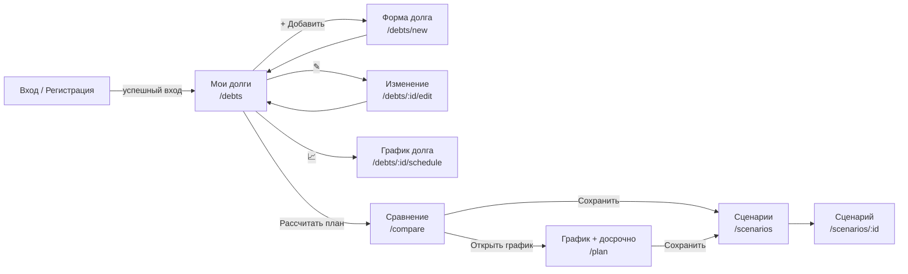
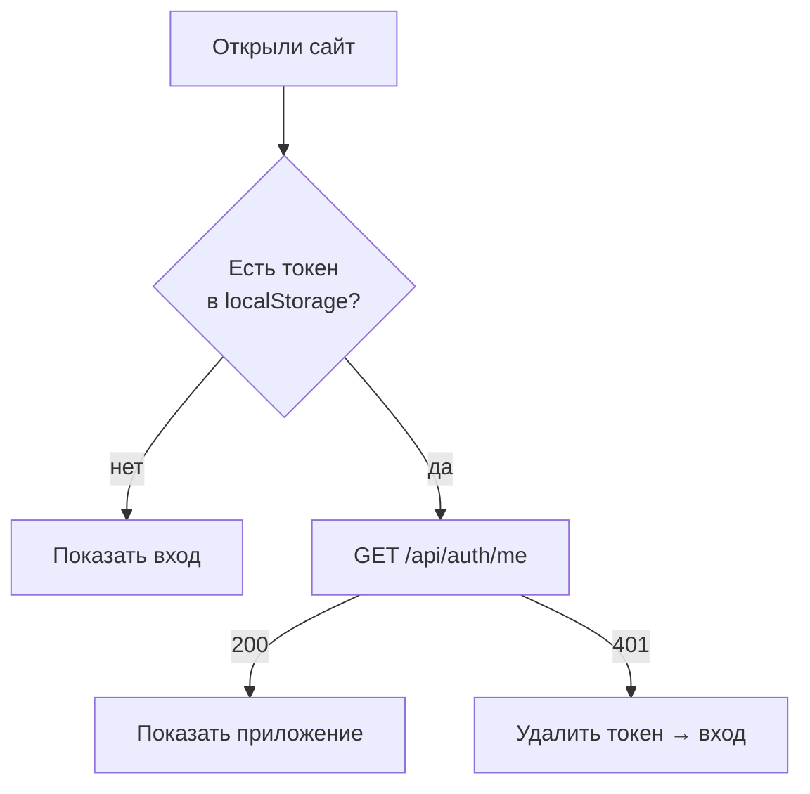

# Прошин — Frontend

> Шпаргалка для защиты. Роль: **клиентская часть** — интерфейс на React, экраны, формы, графики, общение с API, адаптивная вёрстка, сборка и раздача через nginx.
>
> Как читать: сначала раздел 1 (рассказ на 2 минуты), потом разделы 2–9 (детали), в конце — раздел 10 с готовыми ответами на вопросы комиссии.

---

## Содержание

1. [Рассказ на 2 минуты](#1-рассказ-на-2-минуты)
2. [Стек и почему именно он](#2-стек-и-почему-именно-он)
3. [Структура frontend](#3-структура-frontend)
4. [Экраны приложения](#4-экраны-приложения)
5. [Как фронтенд общается с backend](#5-как-фронтенд-общается-с-backend)
6. [Состояние: вход и общий план](#6-состояние-вход-и-общий-план)
7. [Формы и валидация](#7-формы-и-валидация)
8. [Графики и таблицы](#8-графики-и-таблицы)
9. [Вёрстка, адаптивность, сборка и nginx](#9-вёрстка-адаптивность-сборка-и-nginx)
10. [Вопросы комиссии и ответы](#10-вопросы-комиссии-и-ответы)
11. [Шпаргалка цифр](#11-шпаргалка-цифр)

---

## 1. Рассказ на 2 минуты

> «Я отвечал за интерфейс DebtFree. Это **одностраничное приложение (SPA) на React 18**. Навигация между экранами — **React Router**, графики — **Chart.js**, сборка — **Vite**. В продакшене собранные файлы раздаёт **nginx**, он же перенаправляет запросы `/api` на backend.
>
> В приложении 8 экранов: вход и регистрация, список долгов, форма добавления/изменения долга, график отдельного долга, сравнение стратегий, общий график с досрочным погашением, список сценариев и карточка сценария. Экраны соответствуют макету из этапа проектирования.
>
> Вся работа с сервером собрана в одном модуле `api.js`: он подставляет токен, обрабатывает ошибки и превращает ответ сервера об ошибках в понятные сообщения под нужными полями формы. Данные формы проверяются дважды: сразу на клиенте — чтобы пользователь видел ошибку мгновенно, и на сервере — для надёжности.
>
> Бюджет и выбранная стратегия общие для нескольких экранов и запоминаются в браузере. Интерфейс адаптивный — корректно работает от 360 пикселей ширины, то есть на телефоне».

---

## 2. Стек и почему именно он

| Технология | Версия | Зачем | Почему выбрали |
|---|---|---|---|
| **React** | 18.3 | Построение интерфейса из компонентов | Самая распространённая библиотека, компонентный подход, хуки |
| **React Router** | 6.28 | Переходы между экранами без перезагрузки | Стандарт для React, URL у каждого экрана |
| **Chart.js** + **react-chartjs-2** | 4.4 / 5.2 | Графики остатка и переплаты | Лёгкий, интерактивные подсказки, адаптивный |
| **Vite** | 5.4 | Сборщик и dev-сервер | Очень быстрый запуск, горячая перезагрузка, прокси `/api` |
| **nginx** | 1.27 | Раздача готовой сборки в Docker | Быстрый, умеет проксировать и сжимать |
| **Чистый CSS** | — | Стили | Без лишних зависимостей, CSS-переменные для цветов |

Зависимостей всего **5** рабочих + 2 для сборки ([frontend/package.json](../frontend/package.json)). Версии зафиксированы точно, `package-lock.json` в репозитории.

---

## 3. Структура frontend

```text
frontend/
├── index.html              ← единственная HTML-страница, сюда монтируется React
├── vite.config.js          ← порт 5173, прокси /api → localhost:8000
├── nginx.conf              ← конфигурация nginx для Docker
├── Dockerfile              ← сборка: node → nginx
└── src/
    ├── main.jsx            ← точка входа, маршруты, защита «только для вошедших»
    ├── api.js              ← ВСЕ запросы к серверу + токен + ошибки
    ├── context.jsx         ← общее состояние: пользователь, бюджет, стратегия
    ├── format.js           ← форматирование денег, процентов, сроков, разбор ввода
    ├── styles.css          ← стили и адаптивность
    ├── components/         ← переиспользуемые кирпичики
    │   ├── ui.jsx          ← NavBar, Field, ErrorBox, Loading, Stat, RadioGroup
    │   ├── forms.jsx       ← форма досрочного платежа, сохранение сценария
    │   ├── tables.jsx      ← помесячная таблица, порядок погашения
    │   └── charts.jsx      ← график остатка, диаграмма переплаты
    └── pages/              ← экраны
        ├── AuthPage.jsx
        ├── DebtsPage.jsx
        ├── DebtFormPage.jsx
        ├── DebtSchedulePage.jsx
        ├── ComparePage.jsx
        ├── PlanPage.jsx
        └── ScenariosPage.jsx   ← и список, и карточка сценария
```

**Принцип:** страницы (`pages`) собирают экран из компонентов (`components`). Компоненты ничего не знают о конкретном экране — например, `BalanceChart` используется на 4 разных страницах.

---

## 4. Экраны приложения

### 4.1. Карта переходов



Верхнее меню (`NavBar`): **Долги · Сравнение · График · Сценарии** + email и «Выйти».

### 4.2. Описание экранов

| Экран | Файл | Use Case | Что видит пользователь | Запросы к API |
|---|---|---|---|---|
| **Вход / Регистрация** | [AuthPage.jsx](../frontend/src/pages/AuthPage.jsx) | UC-1, UC-2 | Две вкладки, email, пароль. После регистрации сразу вход | `register`, `login`, `me` |
| **Мои долги** | [DebtsPage.jsx](../frontend/src/pages/DebtsPage.jsx) | UC-4, UC-7, UC-9 | Таблица долгов, итог, сумма мин. платежей, поле бюджета, кнопки 📈 ✎ ✕ | `debts`, `deleteDebt` |
| **Форма долга** | [DebtFormPage.jsx](../frontend/src/pages/DebtFormPage.jsx) | UC-5, UC-6, UC-8 | Название, вид, остаток, ставка, мин. платёж, срок, дата, тип платежа | `debt`, `createDebt`, `updateDebt` |
| **График долга** | [DebtSchedulePage.jsx](../frontend/src/pages/DebtSchedulePage.jsx) | UC-10, UC-11, UC-14 | Платёж, срок, переплата, график, таблица по месяцам, панель «Досрочно» | `debt`, `schedule` |
| **Сравнение** | [ComparePage.jsx](../frontend/src/pages/ComparePage.jsx) | UC-13, UC-12 | 3 карточки стратегий, «★ Рекомендуется», диаграмма переплаты, графики остатка, порядок закрытия | `compare` |
| **График + досрочно** | [PlanPage.jsx](../frontend/src/pages/PlanPage.jsx) | UC-11, UC-14, UC-15 | Выбор стратегии и бюджета, 4 показателя, график «база vs досрочно», экономия, таблицы | `compare`, `earlyPayment`, `debts` |
| **Сценарии** | [ScenariosPage.jsx](../frontend/src/pages/ScenariosPage.jsx) | UC-17, UC-18 | Таблица сохранённых расчётов, удаление | `scenarios`, `deleteScenario` |
| **Карточка сценария** | там же, `ScenarioPage` | UC-17 | Параметры, досрочные платежи, показатели, график, таблицы | `scenario` |

### 4.3. Сценарий демонстрации (что показывать на защите)

1. Зарегистрироваться → попадаем на «Мои долги» (пустой список с подсказкой).
2. Добавить 3 долга контрольного примера: карта 60 000 / 29,9 % / 3 000; кредит 200 000 / 15 % / 7 000; рассрочка 30 000 / 0 % / 3 000.
3. **Показать валидацию:** у карты ввести мин. платёж 1 000 → ошибка «Должен быть больше процентов за месяц (1 495 ₽)».
4. Нажать 📈 у кредита → график одного долга: платёж 6 933,07 ₽.
5. Ввести бюджет 20 000 → «Рассчитать план» → сравнение: Лавина 33 003 ₽, Снежный ком 35 954 ₽, Минимальные 73 067 ₽. Лавина отмечена «★ Рекомендуется».
6. «Открыть график» → досрочно 5 000 ₽, «Каждый месяц», «Сократить срок» → «Пересчитать» → **«Экономия: 7 715 ₽ переплаты, срок короче на 4 мес.»**, на графике появилась пунктирная линия.
7. «Сохранить сценарий» → «Лавина +5000» → открыть в «Сценариях».
8. Попробовать удалить долг из сценария → сообщение «Долг используется в сохранённых сценариях…».
9. Сузить окно браузера до ширины телефона — показать адаптивность.

---

## 5. Как фронтенд общается с backend

### 5.1. Один модуль для всех запросов — [api.js](../frontend/src/api.js)

```javascript
async function request(method, path, body) {
  const headers = { "Content-Type": "application/json" };
  const token = getToken();
  if (token) headers.Authorization = `Bearer ${token}`;      // 1. подставить токен
  let res;
  try {
    res = await fetch(`/api${path}`, { method, headers, body: ... });
  } catch {
    throw new ApiError(0, "Сервер недоступен. Проверьте, что backend запущен.");  // 2. нет сети
  }
  if (res.status === 204) return null;                        // 3. удалено, тела нет
  const data = await res.json().catch(() => ({}));
  if (!res.ok) {
    if (res.status === 401 && token) onUnauthorized();        // 4. токен истёк → выйти
    throw new ApiError(res.status, data.detail || `Ошибка ${res.status}`, data.errors);
  }
  return data;
}
```

Дальше — простой объект с методами, страницы вызывают только их:

```javascript
export const api = {
  login: (email, password) => request("POST", "/auth/login", { email, password }),
  debts: () => request("GET", "/debts"),
  compare: (data) => request("POST", "/compare", data),
  earlyPayment: (data) => request("POST", "/early-payment", data),
  ...
};
```

**Почему так (говорить на защите):** если завтра поменяется адрес API или способ авторизации — правим одно место, а не 8 экранов.

### 5.2. Ошибки по полям

Backend отвечает на ошибку валидации так:

```json
{ "detail": "Остаток: должно быть больше 0",
  "errors": [{ "field": "balance", "message": "Остаток: должно быть больше 0" }] }
```

`ApiError` превращает массив в объект:

```javascript
this.fields = { balance: "Остаток: должно быть больше 0" };
```

И форма показывает сообщение прямо под полем «Остаток»: `<Field label="Остаток" error={errors.balance}>`. Если ошибка не привязана к полю (например, «Неверный email или пароль») — показывается общий красный блок `ErrorBox`.

### 5.3. Почему относительный путь `/api`, а не `http://localhost:8000`

- В разработке Vite проксирует `/api` → `localhost:8000` ([vite.config.js](../frontend/vite.config.js)).
- В Docker nginx проксирует `/api` → `backend:8000` ([nginx.conf](../frontend/nginx.conf)).

Код один и тот же, а браузер думает, что фронтенд и API — один сайт. Поэтому **не нужен CORS** и не надо пересобирать фронтенд под разные адреса.

---

## 6. Состояние: вход и общий план

Используется **React Context** — способ передать данные во все компоненты без прокидывания через каждый уровень ([context.jsx](../frontend/src/context.jsx)).

### 6.1. `AuthProvider` — кто вошёл



- Токен хранится в `localStorage` под ключом `debtfree.token` — после перезагрузки страницы не нужно входить заново.
- Пока проверяется токен, показывается «Загрузка…» (флаг `ready`), чтобы не мелькал экран входа.
- `logout()` удаляет токен и пользователя → React сам перерисовывает экран входа.
- Если любой запрос вернул 401 — срабатывает `onUnauthorized` → автоматический выход («Сессия истекла»).

**Защита маршрутов** — в [main.jsx](../frontend/src/main.jsx):

```javascript
function App() {
  const { user, ready } = useAuth();
  if (!ready) return <Loading />;
  if (!user) return <AuthPage />;          // не вошёл — видит только вход
  return ( <PlanProvider> <NavBar /> <Routes>...</Routes> </PlanProvider> );
}
```

Неизвестный адрес перенаправляется на `/debts` (`<Route path="*" element={<Navigate to="/debts" />} />`).

### 6.2. `PlanProvider` — бюджет и стратегия

Бюджет вводится на экране «Долги», а нужен на «Сравнении» и «Графике». Стратегию выбирают на «Сравнении», а нужна она на «Графике». Поэтому они хранятся в общем контексте и **сохраняются в `localStorage`** (`debtfree.plan`) — выбор не теряется при перезагрузке.

Все обращения к `localStorage` обёрнуты в `try/catch`: в режиме инкогнито или при запрете хранилища приложение не падает, просто не запоминает.

---

## 7. Формы и валидация

### 7.1. Двойная проверка

| Где | Зачем |
|---|---|
| **На клиенте** (функция `validate` в [DebtFormPage.jsx](../frontend/src/pages/DebtFormPage.jsx)) | Мгновенная реакция, без запроса на сервер |
| **На сервере** (Pydantic) | Надёжность: клиента можно обойти, сервер — нет |

Клиентские проверки повторяют серверные (UC-8):

```javascript
if (!f.name.trim()) errors.name = "Заполните название";
if (!(num(f.balance) > 0)) errors.balance = "Остаток должен быть больше 0";
if (rate < 0 || rate > 100) errors.annual_rate = "Ставка должна быть от 0 до 100 %";
// мин. платёж должен покрывать проценты месяца:
const interest = Math.round(balance * rate * 100 / 1200) / 100;
if (minPayment <= interest) errors.min_payment = `Должен быть больше процентов за месяц (${interest} ₽)...`;
if (term < 1 || term > 600) errors.term_months = "Срок — от 1 до 600 месяцев";
```

Форма отправляется с `noValidate` — отключены стандартные всплывающие подсказки браузера, чтобы все ошибки выглядели одинаково и были на русском.

### 7.2. Удобный ввод чисел — `parseAmount` ([format.js](../frontend/src/format.js))

Пользователь пишет как привык: `60 000,50`. Функция убирает пробелы (в том числе неразрывные) и меняет запятую на точку → `"60000.50"`. Отправляется **строкой**, чтобы не потерять копейки на `float` в JavaScript — backend сам превращает её в `Decimal`.

Поля сумм — `inputMode="decimal"`: на телефоне открывается цифровая клавиатура.

### 7.3. Проверка бюджета (UC-9)

На экране «Долги» перед переходом к сравнению:

```javascript
if (!budget) return "Укажите ежемесячный бюджет";
if (budget < data.total_min_payments) return "Бюджет не может быть меньше суммы минимальных платежей";
```

Плейсхолдер поля бюджета — сумма минимальных платежей, чтобы пользователь сразу видел нижнюю границу.

### 7.4. Форма «Досрочно» — [forms.jsx](../frontend/src/components/forms.jsx)

Один компонент `ExtraPaymentForm` используется на двух экранах (график долга и общий график):

| Поле | Варианты |
|---|---|
| Сумма, ₽ | число |
| Вид | Разово / Каждый месяц |
| Месяц | «В месяце N» или «Начиная с месяца N» (подпись меняется) |
| На какой долг | «По правилу стратегии» или конкретный долг (только на общем графике) |
| Эффект | Сократить срок / Снизить платёж |

Для стратегии «Только мин. платежи» вариант «Снизить платёж» скрыт (`allowPaymentEffect={false}`) — у неё платёж фиксирован, и backend всё равно бы вернул ошибку.

### 7.5. Сохранение сценария — `SaveScenario`

Кнопка «Сохранить сценарий» раскрывается в поле названия + «Сохранить» / «Отмена». Компонент получает функцию `request()`, которая собирает параметры текущего экрана (стратегия, бюджет, досрочные платежи). После сохранения — зелёное сообщение со ссылкой «Открыть». Используется на трёх экранах.

### 7.6. Защита от двойного нажатия

Во время запроса кнопки блокируются (`disabled={busy}`) и меняют текст: «Считаю…», «Сохраняю…», «Подождите…».

### 7.7. Подтверждение удаления

Перед удалением долга или сценария — `window.confirm("Удалить долг «Кредитная карта»?")`.

---

## 8. Графики и таблицы

### 8.1. `BalanceChart` — линии остатка ([charts.jsx](../frontend/src/components/charts.jsx))

Универсальный компонент: принимает массив серий `{label, color, dashed, timeline, initial}`.

| Где используется | Какие линии |
|---|---|
| Сравнение | 3 линии: Лавина (зелёная), Снежный ком (синяя), Минимальные (красная пунктирная) |
| График + досрочно | «Базовый план» (сплошная) и «С досрочным платежом» (пунктир) |
| График долга | «Без досрочных» и «С досрочным» |
| Сценарий | одна линия цвета стратегии |

Детали:
- Ось X — месяцы от 0 (первая точка — исходный долг `initial`), ось Y — суммы в формате «60 тыс.».
- Подсказка при наведении: «Месяц 5 — Лавина: 210 345,12 ₽» сразу по всем линиям (`interaction: mode: "index"`).
- Точки скрыты (`pointRadius: 0`), но наведение работает (`pointHitRadius: 8`) — линия чистая.

### 8.2. `OverpayChart` — горизонтальные столбцы переплаты

Наглядно видно, что «Минимальные» в 2 раза дороже, а Лавина чуть дешевле Снежного кома. Высота подстраивается под число стратегий. Есть `aria-label` с текстовым описанием для экранных дикторов.

### 8.3. Цвета едины по всему приложению

```javascript
export const COLORS = { avalanche: "#16a34a", snowball: "#2563eb", minimum: "#dc2626", ... };
```

Лавина всегда зелёная, Снежный ком всегда синий — пользователь не путается между экранами.

### 8.4. Таблицы — [tables.jsx](../frontend/src/components/tables.jsx)

- **`MonthTable`** — помесячно: платёж, проценты, основной долг, (досрочно), остаток. Длинные графики **сворачиваются до 12 строк** с кнопкой «Показать все 36 мес.» — иначе ипотека на 600 месяцев растянула бы страницу.
- **`PayoffTable`** — в каком месяце закрывается каждый долг, отсортировано по порядку закрытия. Наглядно показывает разницу стратегий: в Снежном коме первой закрывается рассрочка, в Лавине — карта.

### 8.5. Форматирование — [format.js](../frontend/src/format.js)

| Функция | Пример |
|---|---|
| `fmtMoney(323002.56)` | `323 002,56 ₽` |
| `fmtWhole(33002.56)` | `33 003 ₽` (для карточек) |
| `fmtRate(29.9)` | `29,9 %` |
| `fmtMonths(17)` | `17 мес. (1 г. 5 мес.)` |
| `fmtDate(...)` | `29.10.2026` |

Используется встроенный `Intl.NumberFormat("ru-RU")` — русские пробелы-разделители и запятая.

---

## 9. Вёрстка, адаптивность, сборка и nginx

### 9.1. Стили — [styles.css](../frontend/src/styles.css)

- Цвета заданы **CSS-переменными** в `:root` (`--primary`, `--success`, `--danger`, …) — тему можно поменять в одном месте.
- Сетки на CSS Grid: карточки стратегий, показатели (`stats`), «график + панель досрочно».

### 9.2. Адаптивность (NFR-4: от 360 px)

| Ширина | Что меняется |
|---|---|
| **≤ 860 px** (планшет) | График и панель «Досрочно» друг под другом; показатели в 2 колонки |
| **≤ 640 px** (телефон) | Меню переносится на отдельную строку с горизонтальной прокруткой; карточки стратегий в 1 колонку; формы в 1 колонку; второстепенные колонки таблиц скрываются (`.hide-sm`), а их данные показываются под названием (`.show-sm`) |

Таблицы обёрнуты в `.table-wrap` с горизонтальной прокруткой — страница целиком никогда не «уезжает» вбок.

### 9.3. Сборка и Docker — [Dockerfile](../frontend/Dockerfile)

```text
Этап 1: node:22-alpine
   npm ci           ← ставит ровно версии из package-lock.json
   npm run build    ← Vite собирает папку dist/ (минифицированный JS + CSS)
Этап 2: nginx:1.27-alpine
   копирует dist/ и nginx.conf
   HEALTHCHECK: wget http://127.0.0.1/
```

Итоговый образ содержит **только nginx и статические файлы** — без Node.js и исходников, он маленький и безопасный.

### 9.4. nginx — [nginx.conf](../frontend/nginx.conf)

| Блок | Что делает |
|---|---|
| `location /api/` | Проксирует на `backend:8000` |
| `location ~ ^/(docs\|openapi.json)$` | Проксирует Swagger |
| `location /assets/` | Кеш на **1 год** — у файлов Vite хеш в имени, при изменении меняется имя |
| `location /` | `try_files $uri /index.html` — **SPA-фолбэк**: любой путь (`/plan`, `/scenarios/5`) отдаёт index.html, а маршрут разбирает React Router. Без этого обновление страницы на `/plan` давало бы 404 |
| `gzip on` | Сжатие CSS/JS/JSON |
| Заголовки безопасности | `X-Content-Type-Options: nosniff`, `X-Frame-Options: DENY` (нельзя встроить во фрейм), `Referrer-Policy` |
| `resolver 127.0.0.11` | DNS Docker: адрес backend определяется заново, перезапуск backend не ломает прокси |
| `server_tokens off` | Не показывает версию nginx |
| `client_max_body_size 1m` | Ограничение размера запроса |

### 9.5. Запуск для разработки

```bash
cd frontend
npm install
npm run dev        # http://localhost:5173, /api проксируется на localhost:8000
```

---

## 10. Вопросы комиссии и ответы

**— Почему React?**
Самая популярная библиотека для интерфейсов, компонентный подход: один раз написали `BalanceChart` — используем на 4 экранах. Хуки (`useState`, `useEffect`) делают код компактным.

**— Что такое SPA и чем оно лучше?**
Single Page Application — браузер загружает одну HTML-страницу, а дальше React перерисовывает только нужные части. Переходы мгновенные, без перезагрузки. Минус — нужно настроить сервер отдавать index.html на любой путь, это сделано в nginx.

**— Где хранится токен и безопасно ли это?**
В `localStorage`. Это простой и распространённый вариант для учебного проекта. Риск — XSS-атака могла бы прочитать токен, но React по умолчанию экранирует весь выводимый текст, и мы нигде не вставляем «сырой» HTML. Токен живёт 24 часа. Для продакшена можно перейти на httpOnly-cookie.

**— Зачем проверять данные на клиенте, если сервер всё равно проверяет?**
Для удобства — пользователь видит ошибку сразу, без запроса. Но доверять можно только серверу, поэтому проверка там обязательна. Сообщения на клиенте и сервере одинаковые.

**— Почему суммы отправляются строкой?**
В JavaScript все числа — `float`, `0.1 + 0.2 = 0.30000000000000004`. Строка `"60000.50"` приходит на сервер без искажений и превращается в `Decimal`.

**— Что будет, если токен истечёт посреди работы?**
Сервер вернёт 401, `api.js` вызовет `onUnauthorized` → `logout()` → React покажет экран входа.

**— Что будет, если backend выключен?**
`fetch` выбросит исключение, мы покажем «Сервер недоступен. Проверьте, что backend запущен.» — приложение не падает.

**— Как реализована адаптивность?**
Медиа-запросы на 860 и 640 px: сетки становятся одноколоночными, меню переносится, второстепенные колонки таблиц прячутся, а их данные показываются компактно под названием. Проверяли на ширине 360 px (NFR-4).

**— Почему Chart.js, а не D3?**
D3 мощнее, но требует много кода на каждый график. Chart.js даёт готовые линейные и столбчатые диаграммы с подсказками и адаптивностью из коробки — нам этого достаточно.

**— Почему нет Redux?**
Общего состояния мало: пользователь, бюджет и стратегия. Встроенного React Context хватает, лишняя библиотека усложнила бы проект.

**— Как связаны бюджет на разных экранах?**
Через `PlanProvider`: бюджет введённый на «Долгах» сразу доступен на «Сравнении» и «Графике», и сохраняется в `localStorage`.

**— Откуда фронтенд знает, какая стратегия «рекомендуется»?**
Её выбирает backend (поле `recommended` — стратегия с наименьшей переплатой), фронтенд только рисует значок «★ Рекомендуется». Вся бизнес-логика — на сервере, фронтенд ничего не считает (кроме мгновенной проверки формы).

**— Зачем nginx, если Vite умеет запускать сервер?**
Dev-сервер Vite предназначен только для разработки. nginx — промышленный веб-сервер: быстро отдаёт статику, сжимает, кеширует, проксирует API и добавляет заголовки безопасности.

**— Почему у ссылки на файлы сборки кеш на год?**
Vite добавляет в имя файла хеш содержимого (`index-a8f3c2.js`). Изменился код — изменилось имя, браузер скачает новый файл. А `index.html` не кешируется (`expires -1`), поэтому всегда ссылается на актуальные файлы.

---

## 11. Шпаргалка цифр

| Что | Значение |
|---|---|
| Экранов | 8 (7 файлов страниц) |
| Маршрутов React Router | 8 + перенаправление `*` → `/debts` |
| Переиспользуемых компонентов | 12 (NavBar, Field, ErrorBox, Loading, Stat, RadioGroup, ExtraPaymentForm, SaveScenario, MonthTable, PayoffTable, BalanceChart, OverpayChart) |
| Методов API-клиента | 15 |
| Строк кода `src/` | ~2 100 (из них CSS ~570) |
| Рабочих зависимостей npm | 5 |
| Брейкпоинты | 860 px и 640 px, минимум 360 px |
| Строк в свёрнутой таблице | 12 |
| Порт dev-сервера | 5173 |
| Порт приложения в Docker | 8080 |
| Ключи localStorage | `debtfree.token`, `debtfree.plan` |
